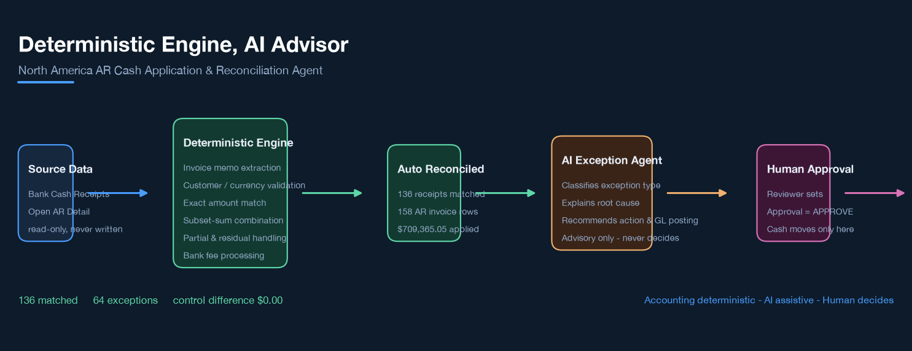

# North America AR Cash Application & Reconciliation Agent

> An AI-assisted Accounts Receivable (AR) cash application platform that combines
> deterministic accounting rules with AI-powered exception resolution to automate
> bank receipt reconciliation.

> **Accounting should be deterministic. AI should be assistive.**

---

## Table of Contents

- [Overview](#overview)
- [Key Features](#key-features)
- [Architecture](#architecture)
- [Technology Stack](#technology-stack)
- [Project Structure](#project-structure)
- [Quick Start](#quick-start)
- [Workflow](#workflow)
- [Deterministic Reconciliation Engine](#deterministic-reconciliation-engine)
- [AI Exception Resolution Agent](#ai-exception-resolution-agent)
- [Human-in-the-Loop Approval](#human-in-the-loop-approval)
- [Output](#output)
  - [Data Quality Checks](#data-quality-checks)
  - [AI Exception Log](#ai-exception-log)
- [Current Capabilities](#current-capabilities)
- [Roadmap](#roadmap)
- [Business Value](#business-value)
- [Documentation](#documentation)
- [Author](#author)

---

## Overview

Manual AR cash application is one of the most repetitive and time-consuming finance
operations. Finance teams often spend hours every day:

- Downloading bank receipts
- Exporting Open AR from ERP
- Matching receipts to invoices
- Investigating payment exceptions
- Handling short payments
- Processing bank fees
- Preparing reconciliation reports

This project transforms that workflow into an AI-assisted reconciliation agent.

It reads a bank statement workbook and an open AR workbook, reconciles them
against deterministic rules, and writes the results — confirmed matches, the
evidence behind them, and AI suggestions for the receipts it cannot settle —
into a single Excel report for a human to review.

Instead of replacing accounting rules with AI, the project follows one design
principle:

> **Accounting should be deterministic. AI should be assistive.**

The reconciliation engine performs all financial calculations using deterministic
rules, while AI is responsible for understanding unstructured payment information,
explaining exceptions, and recommending next actions.

The agent never applies cash and never modifies an AR balance on its own. Its
suggestions are proposals in the report; a human decides what happens next.

The objective is **not** to replace accountants. The objective is to eliminate
repetitive reconciliation work while maintaining financial accuracy, internal
controls, and auditability.

---

## Key Features

### Deterministic Reconciliation Engine

- Invoice reference matching extracted from free-text remittance memos
- Customer & currency validation
- Exact amount matching
- Multi-invoice combination matching (subset sum)
- Bank fee processing
- Partial payment handling
- Short payment detection
- Overpayment handling
- Duplicate payment detection
- FX exception handling
- Refund / chargeback handling
- Control total validation

### AI Exception Resolution Agent

When deterministic matching cannot confidently reconcile a payment, the AI agent:

- Understands bank remittance text
- Extracts payment intent
- Identifies the exception type
- Explains the root cause
- Recommends a specific reconciliation action
- Proposes the general-ledger posting
- Generates human-readable reconciliation notes
- Routes high-risk cases for approval

Everything it produces is a **suggestion written into the report**. The agent
never applies cash, never modifies an AR balance, and never approves its own
proposal — a recommendation only becomes a match after a human acts on it, and
the confirmed rule-based matches stay separate from the suggestions in
separate sheets.

### What one run produces


---

## Architecture

```
        Bank Statement Excel        AR Open Items Excel
                      │                       │
                      └───────────┬───────────┘
                                  ▼
                       Data Validation
                                  │
                                  ▼
              Deterministic Matching Engine
               ├── Invoice Match
               ├── Customer Match
               ├── Currency Match
               ├── Amount Match
               └── Combination Match
                                  │
                 ┌────────────────┴────────────────┐
                 ▼                                 ▼
        Confirmed Matches                   AI Exception Agent
        (rule + evidence)                          │
                                                    ▼
                                        Root Cause Analysis
                                                    │
                                                    ▼
                                       Matching Suggestions
                                                    │
                                                    ▼
                                  Reconciliation Results Excel
```

**The control boundary.** The deterministic engine is the only component that
can move money. The AI agent analyses, explains and recommends — it never applies a
reconciliation on its own. Every AI proposal must pass a validator, and it is only
written back to AR after a human sets `Approval = APPROVE` in the review sheet.

**The output boundary.** Confirmed rule-based matches and AI suggestions are
reported separately and never merged into one column. The report is the
deliverable: the agent applies no cash and changes no AR balance on its own.

**The control boundary.** The deterministic engine is the only component that can
move money. The AI agent analyses, explains and recommends — it never applies a
reconciliation on its own. Every AI proposal must pass a validator, and it is only
written back to AR after a human sets `Approval = APPROVE` in the review sheet.



### The code layout

The code is layered so that the dependency direction is always downwards and a
business rule can be found in one place:

| Layer | Package | Contains |
|---|---|---|
| Primitives | `core/` | Cell parsing, money, the column vocabulary |
| Policies | `rules/` | Thresholds, tolerances, the controlled taxonomies |
| Decisions | `matching/` | The matching algorithms and their controls |
| Advice | `agent/`, `llm/` | Context building, prompting, validation, LLM clients |
| Workflows | `services/` | The reconciliation and approval workflows |
| I/O | `io/` | Reading, writing and formatting workbooks |

A layer may use the layers below it and never the ones above. The rules in
`rules/policies.py` are the ones a Finance reviewer would audit: every tolerance
and every exception taxonomy is stated once, with the reason it has that value.

---

## Technology Stack

| Category | Technology | Status |
|----------|------------|--------|
| Language | Python 3.12 | In use |
| Data Processing | Pandas | In use |
| Excel Processing | OpenPyXL | In use |
| AI (exception analysis) | OpenAI-compatible chat API | In use, optional |
| Version Control | Git | In use |

---

## Project Structure

```
.
├── src/ar_reconciliation/         # The library
│   ├── config.py                   # Project-relative paths and settings
│   ├── cli.py                      # Console entry points
│   ├── core/                       # Shared primitives
│   │   ├── primitives.py           #   Cell parsing, money, text normalisation
│   │   └── schema.py               #   The column vocabulary
│   ├── rules/                      # Financial validation rules
│   │   └── policies.py             #   Thresholds, tolerances, taxonomies
│   ├── matching/                   # The matching engine
│   │   ├── models.py               #   CandidateInvoice, MatchResult
│   │   ├── memo.py                 #   Memo classification
│   │   ├── subset_sum.py           #   Subset-sum matching
│   │   ├── candidates.py           #   Eligibility controls
│   │   ├── algorithms.py           #   The three matching strategies
│   │   └── application.py          #   Writing a match back to the workbook
│   ├── agent/                      # The AI exception agent
│   │   ├── context.py              #   Candidate pool, scoring, context
│   │   ├── prompt.py               #   System prompt and response schema
│   │   ├── rules_backend.py        #   Offline deterministic backend
│   │   ├── validator.py            #   Safety validation of recommendations
│   │   └── exception_agent.py      #   The agent and its CLI
│   ├── llm/                        # LLM integrations
│   │   └── backend.py              #   OpenAI-compatible chat backend
│   ├── services/                   # Reconciliation services
│   │   ├── reconciliation.py       #   The deterministic workflow
│   │   └── review_rows.py          #   Building the review-sheet rows
│   └── io/                         # Workbook I/O
│       └── workbook.py             #   Validation, preservation, formatting
├── scripts/                        # Runnable entry points
│   ├── run_reconciliation.py       #   Run the deterministic engine
│   ├── run_agent.py                #   Run the AI exception agent
│   ├── run_openai.py               #   Run the agent against the OpenAI API
│   ├── run_local_model.py          #   Run the agent against a local model
│   ├── show_result.py              #   Inspect the result from the terminal
│   ├── make_images.py              #   Regenerate the README images
│   └── check_regression.py         #   Compare a run against the baseline
├── data/
│   ├── input/                      # Source workbooks (read-only)
│   │   ├── Bank_Cash_Receipts.xlsx     200 bank receipts
│   │   └── Open_AR_Detail.xlsx         191 open AR rows
│   ├── output/                     # Generated by a run (not committed)
│   │   ├── Open_AR_Detail_Reconciled_Result.xlsx
│   │   └── AI_Exception_Approvals.xlsx
│   ├── sample/                     # The sample dataset
│   └── baseline.json               # Metrics a run must reproduce
├── .env.example                    # Template for .env (the real .env is gitignored)
├── tests/                          # pytest suite
│   ├── conftest.py
│   ├── test_core.py
│   ├── test_engine.py
│   ├── test_agent.py
│   ├── test_approval_workflow.py
│   ├── test_env.py
│   └── test_llm_backend.py
├── docs/
│   ├── images/                    #   README images (regenerated by scripts/make_images.py)
│   ├── data_dictionary.md
│   ├── reconciliation_logic.md
│   ├── scenario_coverage.md
│   ├── ai_exception_agent.md
│   ├── local_models.md
│   └── prompt.md
├── .github/workflows/ci.yml        # Continuous integration
├── pyproject.toml                  # Packaging and tool configuration
├── .gitignore
└── README.md
```

All runnable entry points live in `scripts/`, and all library code lives in
`src/ar_reconciliation/`. Install the package with `pip install -e .` to get the
`ar-reconcile` and `ar-agent` console commands.

---

## Quick Start

### 1. Install dependencies

```bash
python -m venv venv
source venv/bin/activate
python -m pip install -r requirements.txt -r requirements-dev.txt
python -m pip install -e .
```

`requirements.txt` installs `pandas`, `openpyxl` and `openai`. The engine and the
rules backend need only the first two; `openai` is used by the LLM backend.
`pip install -e .` installs the package itself so `ar-reconcile` and `ar-agent`
are available on the command line.

### 2. Configure your API key (optional)

The deterministic engine and the rules backend need no key at all. To use the
LLM backend, put your key in a `.env` file at the repository root:

```bash
cp .env.example .env
```

Then edit `.env` and set your key:

```
OPENAI_API_KEY=sk-...
AR_AGENT_MODEL=gpt-4o-mini
```

`.env` is listed in `.gitignore` and is never committed, so your key stays out
of version control. A key already exported in your shell wins over the file,
so a per-command override still works:

```bash
OPENAI_API_KEY=sk-... python scripts/run_openai.py
```

The project reads `.env` with `python-dotenv` when it is installed and with a
built-in parser otherwise, so nothing extra is required. Install the optional
extra if you prefer it:

```bash
pip install -e ".[dotenv]"
```

### 3. Run the reconciliation engine

```bash
python scripts/run_reconciliation.py
```

This reads the two source workbooks and writes a new result workbook. **The source
files are never modified.**

```
Matched bank receipts              : 136
Matched AR invoice rows            : 158
Pending review receipts            : 67
Unmatched / exception bank receipts: 64
Data quality issues                : 0
Reconciled control difference      : 0.00
```

To look at the result without opening Excel:

```bash
python scripts/show_result.py             # the summary
python scripts/show_result.py sheets      # what is in the workbook
python scripts/show_result.py matches     # how the receipts were matched
python scripts/show_result.py unmatched   # the receipts that need a human
python scripts/show_result.py review      # what the agent recommended
python scripts/show_result.py ar          # the reconciled AR rows
```

### 4. Run the AI exception agent

```bash
# Deterministic, offline. No API key required.
python scripts/run_agent.py

# LLM backend.  The key comes from .env, or from the environment.
python scripts/run_agent.py --backend llm --model gpt-4o

# Local model (Ollama / LM Studio / vLLM) — free and offline
python scripts/run_local_model.py --model qwen2.5:7b
```

The agent writes an `AI Exception Review` sheet and an `AI Exception Log` sheet
into the result workbook, plus a durable `AI_Exception_Approvals.xlsx` ledger.
The log sheet records every repair the validator made to the model's own
recommendation, and stays empty when there was nothing to repair.

See [Free and Open-Source Model Backends](docs/local_models.md) for the local
model setup, model selection and privacy notes.

### 5. Review the report

Open the result workbook. The `AI Exception Review` sheet holds the AI's
suggestion for every receipt the engine could not settle: the exception type,
the root cause, the proposed invoice and amount, and the reasoning behind it.

This is where the MVP ends. The report is the deliverable — read it, check the
evidence, and decide what to do next.

### 6. Optionally apply human approvals

> Not part of the MVP scope — this is an optional local path for acting on the
> report. See [Roadmap](#roadmap).

If you want the agent's proposals applied back to AR, set `Approval` to
`APPROVE` on the rows you accept, then run:

```bash
python scripts/run_agent.py --apply-approved
```

Only the approved rows are applied to AR. The control totals are re-verified
afterwards, and the workbook is left untouched if they do not balance.

### 7. Run the tests

```bash
python -m pip install -r requirements.txt -r requirements-dev.txt
python -m pytest tests/
```

The suite covers the money and text primitives, the matching engine, the AI
agent's safety rules and the human approval gate. It runs against the sample
data in this repository, so it exercises the real rules rather than a model of
them.

### 8. Regenerate the README images

The pictures in this README are built from a real run, so the numbers in them
are the numbers the project actually produces.

```bash
python -m pip install -r requirements-dev.txt
python scripts/make_images.py
```

---

## Testing

The matching rules are the most valuable thing in this project, and they are
also the easiest thing to break by accident. Every rule change is therefore
guarded by a test.

| Suite | What it covers |
|---|---|
| `tests/test_core.py` | Money parsing, text keys, blank detection. The edge cases that decide whether a control total is right. |
| `tests/test_engine.py` | The nine behaviours in [Scenario Coverage](docs/scenario_coverage.md), plus the invariants that hold on every run: source columns untouched, no receipt applied twice, control totals balance, no receipt silently dropped. |
| `tests/test_agent.py` | The validator: an invoice outside the candidate pool is discarded, an amount above the cash is capped, a residual is recomputed from the AR data, a review-only scenario is never auto-matched. |
| `tests/test_approval_workflow.py` | The approval gate: nothing is applied without an explicit approval, applying twice is idempotent, and the control totals still balance afterwards. |
| `tests/test_llm_backend.py` | The LLM code path: request building, JSON parsing and validation against a fake OpenAI-compatible server, with no network access and no API key. |

### The regression baseline

`data/baseline.json` stores the metrics a run must reproduce: row counts, the
applied-amount control totals, the status distribution and the match methods.
`scripts/check_regression.py` compares a fresh run against it:

```bash
python scripts/check_regression.py data/baseline.json
```

This answers "did the numbers move?" in one command, which is the question
you want answered before every release. If a matching rule is changed on
purpose, re-record the baseline and update the tables in
[Scenario Coverage](docs/scenario_coverage.md) in the same change.

### Continuous integration

`.github/workflows/ci.yml` runs the test suite, the offline LLM check, the
full pipeline and the baseline comparison on every push and pull request, on
Python 3.12 and 3.13.

---

## Workflow

### Step 1 — Import

Read `Bank_Cash_Receipts.xlsx` (sheet `Bank Receipts`) and `Open_AR_Detail.xlsx`
(sheet `Open AR`).

### Step 2 — Validate source data quality

Detect AR rows that are closed or reconciled but still carry a non-zero open
amount. Findings go to the `Data Quality Checks` sheet, and such rows are
excluded from auto-matching. The sheet is empty when the source data is
consistent — see [Data Quality Checks](#data-quality-checks).

### Step 3 — Extract invoice references

Parse free-text remittance memos for invoice numbers and classify the memo into a
scenario (short pay, bank fee, duplicate, dispute, and so on).

### Step 4 — Deterministic reconciliation

Run the matching engine: invoice reference first, then customer / currency /
amount combination matching with subset-sum.

### Step 5 — Auto-reconcile

Apply the confident matches to AR and to the bank receipts. Partial payments,
short pays and overpayments stay in `Pending Review`.

### Step 6 — Route to the AI Exception Agent

Every receipt that could not be reconciled is analysed by the agent, which
classifies the exception, explains the root cause and recommends a next action.

### Step 7 — Report

The confirmed matches, the unmatched receipts, the AI suggestions and the
control totals are written into the reconciliation results workbook. This is
where the MVP ends: a human reads the report and decides what to do next.

An optional local path then applies the recommendations a human approved —
see [Human-in-the-Loop Approval](#human-in-the-loop-approval).

---

## Deterministic Reconciliation Engine

`scripts/run_reconciliation.py` performs the matching. Its rules are documented in
full in [Reconciliation Logic](docs/reconciliation_logic.md).

### Match priority

| Priority | Rule | Notes |
|---|---|---|
| 1 | Memo invoice reference, exact amount | Strongest evidence of intent |
| 2 | Memo invoice reference, within rounding tolerance | ±$0.02 |
| 3 | Memo invoice reference, partial / short / overpayment | Bounded residual only |
| 4 | Customer + currency + exact amount | Single invoice |
| 5 | Customer + currency + subset-sum combination | Multiple invoices |
| 6 | Customer + currency + partial combination | Only when one candidate is plausible |

### Two-pass ordering

Receipts whose memo names an invoice are processed **first**. Receipts without a
memo reference are processed **second**, so a combination match can never consume
an invoice that a memo-referenced receipt already named.

### Key behaviours

- **Exact decimal arithmetic.** All money is converted to integer cents with
  `ROUND_HALF_UP`. No float arithmetic touches a monetary value.
- **Installments.** An invoice may be settled by several receipts. The applied
  amount and the transaction ID list accumulate, and the invoice only closes when
  the residual reaches zero.
- **Bank fees.** The invoice is cleared at the net cash received; the fee is
  flagged for a separate GL booking.
- **Controlled fallbacks.** A missing ERP Customer ID can be resolved from the
  customer name when it resolves to exactly one ERP customer. A parent entity
  paying a child's invoice is matched through the AR `Parent Customer ID`.
- **Control totals.** The AR applied amount must equal the bank applied amount
  exactly, or the run fails before anything is written.

### Source data is never modified

`Open Amount`, `AR Status` and `Reconciliation Status` in the source workbook are
never written to. Every result goes into new output columns, with the suggested
status in `Suggested Recon Status` and `Suggested Bank Status`.

### Shared primitives (`core/primitives.py`)

The engine and the AI agent both need to turn spreadsheet cells into comparable
values. Those conversions live in `src/ar_reconciliation/core/primitives.py` so
there is exactly one definition of what a cell means:

- `money_to_cents` / `cents_to_money` — money as integer cents, half-up rounding.
- `normalize_text` / `normalize_key` / `normalize_invoice` — canonical text keys.
- `is_blank` — what counts as an empty cell.

Two rules hold everywhere:

1. **Money parsing never guesses.** A value that cannot be read as an amount
   raises `MoneyParseError` instead of collapsing to zero. A silent zero is
   dangerous because every downstream control total — including the AI
   recommendation validator — would treat it as a real value and confirm it.
2. **Text keys are canonical.** `ACME-CORP`, `ACME Corp.` and `acme corp` all
   produce the same key, so the customer-name and invoice fallbacks behave the
   same on both sides of the pipeline.

---

## AI Exception Resolution Agent

`src/ar_reconciliation/agent/` analyses the receipts the deterministic engine
could not resolve. It is documented in full in [AI Exception Agent](docs/ai_exception_agent.md).

### What it does

For each unmatched receipt it produces a structured judgement:

| Field | Meaning |
|---|---|
| `AI Exception Type` | One of 20 controlled exception types |
| `Root Cause` | Why the receipt did not match |
| `Recommended Action` | Auto Match / Recommend Match / Manual Review / Hold & Escalate / Return to Customer |
| `AI Confidence` | High / Medium / Low |
| `Proposed Invoice Numbers` | The invoices it believes the cash belongs to |
| `Proposed Applied Amount` | How much to apply |
| `Proposed Residual Amount` | What stays open on the invoice |
| `Accounting Treatment` | How the accounting should be handled |
| `Proposed GL Posting` | The journal entry it would propose |
| `AI Explanation` | The narrative for the AR analyst |

### Two backends

- **`rules`** — a deterministic, offline heuristic analyzer. It is the default, so
  the pipeline runs and is testable with no API key and no network access.
- **`llm`** — an OpenAI-compatible chat-completions endpoint. This works with
  hosted APIs (OpenAI, Azure) and with **free local models** (Ollama, LM Studio,
  llama.cpp, vLLM). The model receives the receipt, its memo and the candidate
  open invoices, and returns a structured JSON judgement.

Both backends run through the **same validator**, so the safety guarantees do not
depend on which one is used.

### Structured output

The agent negotiates a grammar-constrained response format. Where the endpoint
supports `json_schema` (Ollama, llama.cpp, vLLM, OpenAI), the decoder itself
prevents an off-schema answer — the model physically cannot emit a value outside
the controlled vocabulary. Endpoints without that support fall back to plain JSON
mode, and the validator covers the difference.

This matters most for local models: a 7B model without the constraint tends to
echo the input back instead of answering.

See [Free and Open-Source Model Backends](docs/local_models.md).

### The validator

The model is never trusted. Every answer is repaired or downgraded:

- An invoice outside the candidate pool is discarded.
- An amount above the cash received is capped.
- An amount above the combined open amount of the proposed invoices is capped.
- A residual that disagrees with the AR data is recomputed from the AR data.
- `Auto Match` requires `High` confidence.
- A low-confidence answer is downgraded to `Manual Review`.
- A scenario the engine marked review-only can never be auto-matched.
- A receipt with no positive net amount (refund, chargeback) can never be applied.

Every repair is recorded in the `AI Exception Log` sheet, so the gate is
auditable rather than merely asserted. That sheet is empty in this repository
because the rules backend already produces the most conservative action
available for every receipt it cannot settle, leaving the validator nothing
to downgrade — see [AI Exception Log](#ai-exception-log).

---

## Human-in-the-Loop Approval

> **Not part of the MVP scope.** The MVP produces a report; this section
> describes an optional local path for acting on it. The code works and is
> useful for a walkthrough, but a hosted approval service is explicitly out of
> scope — see [Roadmap](#roadmap).

The agent recommends. It does not decide.

```
AI recommendation
        │
        ▼
  Human review  ──── Approval = APPROVE ────┐
        │                                     │
        │                                     ▼
        │                            Applied to AR
        │                                     │
        └── Approval = REJECT / blank         ▼
              stays in the queue      Control totals re-verified
```

The approval is a hard gate. Nothing is written to AR without it, the process is
idempotent (re-running never applies the same receipt twice), and the durable
`AI_Exception_Approvals.xlsx` ledger keeps the reviewer's decisions across
re-runs of the reconciliation engine.

An approval is only carried over while the proposal itself is unchanged. If the
recommendation moves to a different invoice or a different amount, the stale
approval is dropped and the row goes back for review.


---

## Output

The MVP produces one workbook. It carries the matching evidence for every row
— the source transaction ID, the rule that fired, the discrepancy and the
reasoning — so a reviewer can judge each match without opening the source
files.

### `Open_AR_Detail_Reconciled_Result.xlsx`

| Sheet | Purpose |
|---|---|
| Reconciled Open AR | Open AR detail with match results, applied/residual amounts and notes. |
| Processed Bank Receipts | Bank receipts with match method, extracted invoices and suggested status. |
| Unmatched Bank Receipts | Receipts routed to review or exception, with the reason. |
| Data Quality Checks | AR data quality issues found during processing. Empty when the source data is consistent — see [Data Quality Checks](#data-quality-checks). |
| Summary | Run metrics and the AR/bank control total check. |
| AI Exception Review | The AI agent's recommendation for each unmatched receipt, with the approval column. |
| AI Exception Log | Every validation repair, model error and apply outcome. Empty when nothing had to be repaired — see [AI Exception Log](#ai-exception-log). |

**Confirmed matches and AI suggestions are reported separately and are never
mixed.** A row in `Reconciled Open AR` and `Processed Bank Receipts` carries a
`Match Method` — the rule that fired — and a `Reconciliation Notes` cell naming
the source transaction, the invoices it settled, the amount applied and the
reason. Those are the confirmed, rule-based matches. A row in
`AI Exception Review` carries an `AI Exception Type`, a root cause, a proposed
invoice and amount, and an `AI Explanation`; those are the suggestions, and
they are proposals only.

The two sets never share a column, so a suggestion can never be read as a
confirmed match. Nothing in this report applies cash on its own, and the
source columns `Open Amount`, `AR Status` and `Reconciliation Status` are
never modified — every result lands in a new output column.

Every reviewable sheet has a frozen header row and an auto-filter, so the
reviewer can narrow a 200-row sheet down to the receipts they need to act on.

### Reading the `Unmatched Bank Receipts` sheet

The sheet carries what a reviewer needs to judge a receipt without opening the
AR workbook:

| Column | Meaning |
|---|---|
| `Reason` | Why the engine could not reconcile the receipt. |
| `Candidate Invoice Count` | How many open AR invoices exist for this customer and currency. |
| `Candidate Open AR Total` | What those open invoices are worth in total. |
| `Suggested Invoices` | The open invoices the receipt most plausibly belongs to. |
| `Suggested Open Amount` | What those suggested invoices are worth. |
| `Receipt vs Open Difference` | How far the receipt is from settling them. |

A difference of `0.00` usually means the receipt would settle the invoice
exactly but was held back for another reason (a collector hold, a tax
withholding, a dispute) — the reviewer only has to confirm that reason, not
re-derive the match.

### Data Quality Checks

Rows of the source AR that are internally inconsistent and therefore must not
be auto-matched. The check is narrow on purpose: an AR row that is marked
`Closed` or `Reconciled` but still carries a non-zero Open Amount cannot be
matched safely, so it is reported instead of silently skipped.

| Column | Meaning |
|---|---|
| `Issue` | What is wrong with the row. |
| `AR Row Index` | The row's index in the source workbook, so the source can be corrected. |
| `ERP Customer ID`, `Customer Name`, `Invoice Number` | Which row it is. |
| `Open Amount` | The balance that should have been zero. |
| `AR Status`, `Reconciliation Status` | The status that contradicts the open amount. |
| `Recommendation` | What to do about it — review the ERP data sync or the source mapping. |

**The sheet is empty in this repository, and that is the expected result.**
The sample dataset has 191 AR rows and every one of them is `Open` in both
`AR Status` and `Reconciliation Status`, so there is no inconsistent row to
report. The sheet keeps its headers even when it is empty, so a reviewer can
tell "no issues found" apart from "the check never ran".

### AI Exception Log

The audit trail of the agent's safety gate and of the approval pass. A row is
written every time a recommendation was **changed** before it reached the
review sheet, and every time the reviewer's approval was **acted on**.

**Analysis phase** — what the agent did with its own recommendation:

| `Outcome` | What it means |
|---|---|
| `Validation` | The validator downgraded the recommendation — for example an `Auto Match` on a review-only scenario became a `Recommend Match`. The `Detail` column says which rule fired. |
| `Model Error` | The model call failed. The agent fell back to the deterministic rules backend for that receipt, and the error is recorded here. |
| `Skipped` | The receipt was not present in the processed bank receipts sheet, so it could not be analysed. |

**Approval phase** — what `--apply-approved` did with the reviewer's decision:

| `Outcome` | What it means |
|---|---|
| `Applied` | The approved amount was written to AR against the named invoices. |
| `Adjusted` | The approved amount exceeded the amount still open on the invoice, so it was capped. The receipt still received cash, just less than was approved. |
| `Rejected` | The approval could not be carried out — the row named no invoice, the invoice carried no open balance, the amount was zero or negative, or the invoice had already been applied by another receipt. The reason is in `Detail`. |
| `Skipped` | The receipt had already been applied to AR. Re-running never applies the same cash twice. |

**The sheet is empty in this repository, and that is also the expected
result.** The deterministic rules backend already recommends `Manual Review`,
`Hold / Escalate` or `Return to Customer` for every receipt it cannot settle
confidently — the most conservative action available — so there is nothing
left for the validator to downgrade, and nothing to log. The approval phase
adds nothing either, because no receipt has been approved yet.

The log is what makes the gate auditable rather than merely asserted. A
documented example: `qwen3:8b` classified `BTRX-000158`, a tax withholding
receipt, as `Short Payment` and returned `Auto Match` with `High` confidence.
The validator caught it twice over — the `Tax Withholding` scenario is
review-only in the deterministic engine, so the action was downgraded to
`Recommend Match`, and the invoice and amount it proposed were both correct.
That repair is one row in this sheet.

Both sheets keep their headers when empty, so a workbook always shows the
same shape.

### `AI_Exception_Approvals.xlsx`

The durable review ledger. It holds the review sheet, including the reviewer's
decisions, so they survive a re-run of the reconciliation engine.

---

## Current Capabilities

**Implemented**

- Invoice reference matching from free-text memos
- Customer & currency validation
- Exact amount matching
- Multi-invoice subset-sum matching
- Partial payment, short pay and overpayment handling
- Bank fee processing
- Duplicate payment detection
- Installment handling across multiple receipts
- Parent/child customer and missing-customer-ID fallbacks
- Exception reporting and control totals
- AI exception analysis with a deterministic and an LLM backend
- Human approval gate with a durable ledger and idempotent write-back
- Automated test suite covering the matching rules, the AI safety rules and
  the approval gate
- Continuous integration with a stored regression baseline

**Out of scope for the MVP**

- Automated posting to a general ledger
- Approval workflow service, email notification and SSO
- Multi-currency revaluation and FX rate tables
- Persistent storage (the engine is file-based by design)

See [Roadmap](#roadmap) for why each of these was dropped and what the MVP
scope is instead.

---

## Roadmap

The goal is a portfolio-ready Finance AI Agent MVP: a working, demonstrable
agent — not an ERP platform.

**MVP scope**

| | |
|---|---|
| Input | Bank Statement Excel + AR Open Items Excel |
| Output | Reconciliation Results Excel |
| Storage | None. File-based, read-only sources |

The MVP stops at the report. It reads two workbooks, reconciles them against
deterministic rules, adds AI suggestions for the receipts it cannot settle,
and writes everything — the evidence and the suggestions — into one Excel
report for a human to read.

**Delivered**

- [x] Rule-based reconciliation engine — deterministic matching in exact
      integer cents, one-to-one and one-to-many
- [x] Matching evidence in the report — source transaction IDs, the rule that
      fired, the discrepancy and the reasoning, per row
- [x] AI exception investigation and matching suggestions — deterministic and
      LLM backends behind one interface; suggestions are written to the report
      as proposals, never applied
- [x] Clear separation of confirmed and suggested — rule-based matches and
      AI-suggested matches are reported separately and are never mixed
- [x] Duplicate-application prevention — a receipt is never applied twice
- [x] Regression tests — 119 tests and a stored baseline

**Out of scope for the MVP**

The MVP deliberately stops at the report. These were considered and dropped:

| Dropped | Why |
|---|---|
| Approval workflow service | The MVP produces a report for a human to read and act on. A hosted approval flow is a deployment decision, not a demonstration requirement |
| Email notifications | The reviewer opens the report. Notification is a deployment decision |
| SSO | There is no multi-tenant user model in the MVP |
| GL posting | The agent never posts. It advises |
| Complex audit trail | The report carries the evidence per row. A separate audit system is not needed to show the reasoning |
| PostgreSQL | The engine is file-based by design |
| n8n workflow automation | Two script invocations are the whole workflow |
| Power BI dashboard | The Excel report answers the questions a dashboard would |
| Live ERP integration | Nothing posts to a ledger. The agent advises; a human decides |

The local approval path described in
[Human-in-the-Loop Approval](#human-in-the-loop-approval) still works and is
still useful for a local walkthrough, but it is not part of the MVP scope
above.

---

## Business Value

This project is designed for enterprise Finance Transformation initiatives.
Potential use cases include:

- Accounts Receivable Automation
- Finance Shared Services
- Cash Application
- Treasury Operations
- Finance Systems Modernization
- AI-Powered Finance Automation

---

## Documentation

- [Reconciliation Logic](docs/reconciliation_logic.md) — matching rules, output statuses, match methods
- [AI Exception Agent](docs/ai_exception_agent.md) — the agent's design, safety rules and review workflow
- [Free and Open-Source Model Backends](docs/local_models.md) — running the agent on a free local model
- [Data Dictionary](docs/data_dictionary.md) — every input and output column
- [Scenario Coverage](docs/scenario_coverage.md) — S01–S40 scenario reference and measured baseline
- [Prompt](docs/prompt.md) — the original automation specification

---

## Author

**Ke Zhang**

MS in Computer Software Engineering
Former Senior Accountant (Tesla)
AI Automation Engineer | Finance Systems | Python | Power BI | SQL
