# North America AR Cash Application & Reconciliation Agent

> An AI-assisted Accounts Receivable (AR) cash application platform that combines
> deterministic accounting rules with AI-powered exception resolution to automate
> bank receipt reconciliation.

> **Accounting should be deterministic. AI should be assistive.**

---

## Table of Contents

- [Overview](#overview)
- [Key Features](#key-features)
- [Architecture](#architecture)
- [Technology Stack](#technology-stack)
- [Project Structure](#project-structure)
- [Quick Start](#quick-start)
- [Workflow](#workflow)
- [Deterministic Reconciliation Engine](#deterministic-reconciliation-engine)
- [AI Exception Resolution Agent](#ai-exception-resolution-agent)
- [Human-in-the-Loop Approval](#human-in-the-loop-approval)
- [Financial Policy Enforcement](#financial-policy-enforcement)
- [AR Intelligence Review Application](#ar-intelligence-review-application)
- [Evidence-Enriched Cash Application](#evidence-enriched-cash-application)
- [Evidence-Based Exception Resolution](#evidence-based-exception-resolution)
- [Output](#output)
  - [Data Quality Checks](#data-quality-checks)
  - [AI Exception Log](#ai-exception-log)
- [Current Capabilities](#current-capabilities)
- [Roadmap](#roadmap)
- [Business Value](#business-value)
- [Documentation](#documentation)
- [Author](#author)
- [License](#license)

---

## Overview

Manual AR cash application is one of the most repetitive and time-consuming finance
operations. Finance teams often spend hours every day:

- Downloading bank receipts
- Exporting Open AR from ERP
- Matching receipts to invoices
- Investigating payment exceptions
- Handling short payments
- Processing bank fees
- Preparing reconciliation reports

This project transforms that workflow into an AI-assisted reconciliation agent.

It reads a bank statement workbook and an open AR workbook (optionally enriched
with a Customer Master, a Contract and Payment Schedule, Remittance Advice and
payment emails), reconciles them against deterministic rules, and writes the results — confirmed matches, the
evidence behind them, and AI suggestions for the receipts it cannot settle —
into a single Excel report for a human to review.

Instead of replacing accounting rules with AI, the project follows one design
principle:

> **Accounting should be deterministic. AI should be assistive.**

The reconciliation engine performs all financial calculations using deterministic
rules, while AI is responsible for understanding unstructured payment information,
explaining exceptions, and recommending next actions.

The agent never applies cash and never modifies an AR balance on its own. Its
suggestions are proposals in the report; a human decides what happens next.

The project delivers two things:

- **An Excel reporting package.** It opens on an Executive Dashboard and carries the cash application by currency, the financial controls, exception analysis, AR aging and the full audit trail.
- **AR Intelligence, a multipage review application.** Finance teams use it to import data, work the exception queue, investigate receipts with their supporting documents and record decisions.

Every decision follows the same order:

1. **Deterministic rules** match what they can prove.
2. **AI** explains the rest and proposes a resolution.
3. **Deterministic financial policy** decides whether that proposal may be executed at all.
4. **A person** approves or rejects it.

The objective is **not** to replace accountants. The objective is to eliminate
repetitive reconciliation work while maintaining financial accuracy, internal
controls, and auditability.

---

## Key Features

### Deterministic Reconciliation Engine

- Invoice reference matching extracted from free-text remittance memos
- Customer & currency validation
- Exact amount matching
- Multi-invoice combination matching (subset sum)
- Bank fee processing
- Partial payment handling
- Short payment detection
- Overpayment handling
- Duplicate payment detection
- FX exception handling
- Refund / chargeback handling
- Control total validation

### AI Exception Resolution Agent

When deterministic matching cannot confidently reconcile a payment, the AI agent:

- Understands bank remittance text
- Extracts payment intent
- Identifies the exception type
- Explains the root cause
- Recommends a specific reconciliation action
- Proposes the general-ledger posting
- Generates human-readable reconciliation notes
- Routes high-risk cases for approval

Everything it produces is a **suggestion written into the report**. The agent
never applies cash, never modifies an AR balance, and never approves its own
proposal — a recommendation only becomes a match after a human acts on it, and
the confirmed rule-based matches stay separate from the suggestions in
separate sheets.

### Financial Policy Enforcement

Deterministic financial rules take precedence over AI recommendations.
`agent/policy.py` evaluates the rules below for each receipt's current
proposal. They read only deterministic data (memo scenario, AR status,
amounts), never the recommendation text.

| Rule | Control | Blocks execution when |
|---|---|---|
| FP-01 | Customer Identity | an invoice is outside the receipt's customer and currency (third parties only when documented) |
| FP-02 | Invoice Eligibility | an invoice is disputed, on hold or closed |
| FP-03 | Hold Restriction | the scenario is hold-only (collector hold, refund, chargeback, credit memo, lockbox batch, and on-account unless a document resolves it) |
| FP-04 | Currency Consistency | invoice and receipt currencies differ |
| FP-05 | Amount Conservation | the amount exceeds the receipt's gross amount or the open balance |
| FP-06 | Duplicate Prevention | the receipt was already applied |
| FP-07 | Evidence Requirements | linked documents are insufficient or conflicting |
| FP-08 | Adjustment Authorization | (informational) adjustments that passed validation |
| FP-09 | Proposal Validation | the proposal failed deterministic validation |
| FP-10 | Approval Requirement | (informational) a reviewer must approve |

**Example from the sample data:** BTRX-000168 is a Collector Hold on INV-900186.

- AI recommendation: Hold / Escalate.
- Potential allocation: USD 7,125.00.
- Authorized allocation: USD 0.00.
- Execution allowed: No.
- Required action: obtain an authorized collector hold release.

Before this rule was enforced at approval, an approved proposal on a hold-only
scenario could have been applied.

---

## AR Intelligence Review Application

```bash
python -m pip install -r requirements.txt -r requirements-ui.txt
streamlit run app/review_app.py
```

| Page | Purpose |
|---|---|
| Overview | Executive summary: workflow statuses, KPIs, match vs. review status, cash application by currency, exceptions, controls, management attention |
| Enrichment Impact | Baseline (bank + AR) vs. enriched run: automation rate, matching accuracy, review workload, AI usage, input status, proposed deductions |
| Data Import | Choose *Upload My Files*, *Use Synthetic Sample Data* or *Use Synthetic Enriched Demo*; optional structured inputs; validate, preview, run once |
| Reconciliation | Every receipt with its result; views, search, filters, CSV export, detail panel |
| Exception Workbench | Prioritized queue with search, filters, sorting, batch investigation and export |
| Exception Investigation | One receipt: bank transaction vs. candidate invoices, evidence, AI analysis (labeled), rule results, final policy decision, review |
| Evidence Center | Document upload and linking; read-only mailbox sync (demo mailbox, optional Gmail); lifecycle Uploaded → Parsed → Linked → Retrieved → Cited |
| Financial Controls | Control matrix by currency, transactions blocked by policy, overridden AI proposals |
| Reports | Excel package and CSV extracts with period and run ID |
| Audit History | Runs, investigations, validations, decisions and executions |
| Settings | Reviewer, AI-assisted mode (key never displayed), read-only policy configuration, diagnostics |

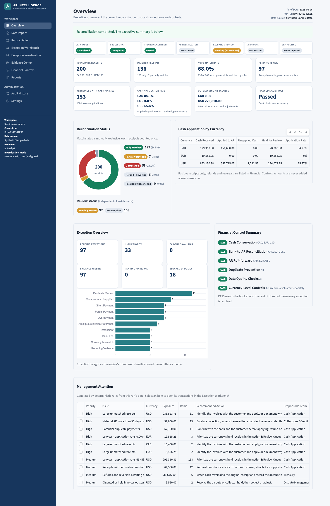

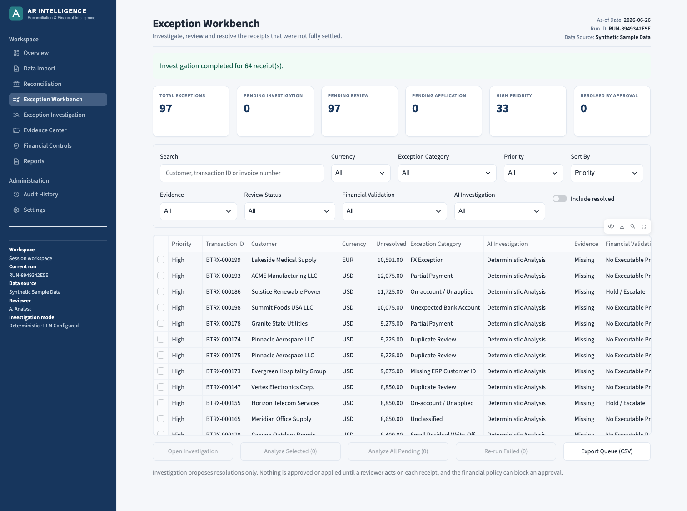

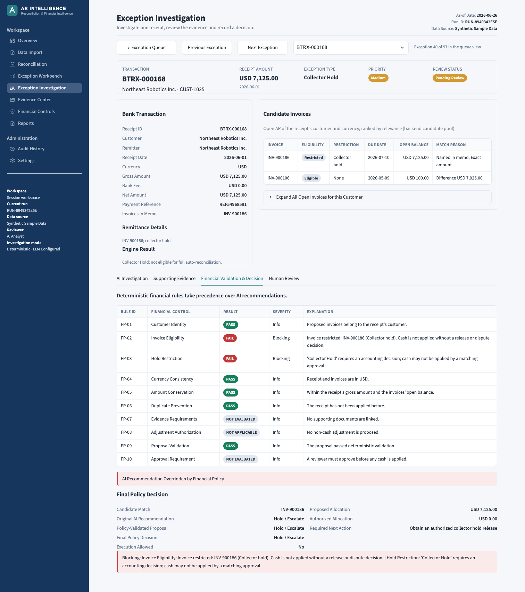

**Notes**
- The reconciliation run, uploaded files, selections and filters survive page navigation.
- Figures are cached by the workbook's modification time, so a decision or an application refreshes them immediately.
- Document text and memos are HTML-escaped and treated as untrusted input.
- Errors are shown as plain messages, never as tracebacks.
- The application covers the review workflow up to the approval write-back; it does not post to an ERP.

**Limitations**
- **Review workflow:** simulated (self-declared reviewer, no SSO), and Escalate / Modify are not separate actions.
- **Storage:** each session works in a temporary workspace (download the Excel package to keep results).
- **AI-assisted investigation:** needs `OPENAI_API_KEY`; otherwise the deterministic analysis is used and labeled.

Before and after screenshots are in [`docs/images/ui/`](docs/images/ui/).

---

## Evidence-Based Exception Resolution

For receipts in Needs Review, a finance user can attach the customer's
contract, email or remittance advice:

- Documents are stored unchanged and read-only, with a SHA-256 hash, and
  linked many-to-many to receipts
- Payment facts (invoices, allocations, discount terms, instalments,
  deductions, "paid on behalf of") are extracted with the exact quote and
  page/line they came from
- The agent proposes per-invoice allocations and, only when a document
  supports them, an early-payment discount or a customer deduction
- Deterministic Python validates every number; conflicting or insufficient
  evidence keeps the receipt in review
- A reviewer approves, rejects or requests more evidence; an approved
  resolution is applied exactly once and recorded in an audit trail
- Controls are recalculated per currency; a break leaves the report
  unfinalised and writes a diagnostic workbook

See [Evidence-Based Exception Resolution](#evidence-based-exception-resolution).

### Evidence-Enriched Cash Application

- Optional structured inputs (Excel or CSV): Customer Master, Contract and Payment Schedule, Remittance Advice. They are validated and turned into per-receipt facts **before** matching
- Remittance allocations and contract instalments settle receipts the bank memo alone cannot, through the same engine and controls; conflicting or ambiguous evidence always goes to review
- Deductions stated in a remittance are proposed as Authorized or Unauthorized against the contract and never applied without a reviewer
- Optional read-only Gmail sync (plus a synthetic local mailbox): incremental, deduplicated, parsed once; email facts feed review and the AI only
- Measured before/after comparison: automation rate, matching accuracy, review workload and LLM calls

See [Evidence-Enriched Cash Application](#evidence-enriched-cash-application).

### Financial Policy Enforcement

- One deterministic policy decision per receipt (`agent/policy.py`), with rule results FP-01 to FP-10: customer identity, invoice eligibility, hold restrictions, currency, amount conservation, duplicates, evidence, adjustments, proposal validation and approval
- An AI proposal that breaks a blocking rule is shown as **AI Recommendation Overridden by Financial Policy**, with its authorized allocation set to zero
- The approval write-back enforces the same decision, so neither the UI nor an edit in Excel can apply a blocked proposal

### Enterprise Reporting Package

- The workbook opens on an Executive Dashboard: workflow statuses, KPI cards, cash application by currency, control center and management attention
- Amounts are never added across currencies; a consolidated total requires an FX-rate file
- Match, Review and Posting status are independent; Match Status is mutually exclusive
- Exception Analysis, Action & Review Queue, AR Aging & Customer Risk, Control Reconciliation, AI Decision & Evidence, Metric Definitions and Run Metadata sheets

### AR Intelligence Review Application

- A multipage Streamlit application with 11 pages: Overview, Enrichment Impact, Data Import, Reconciliation, Exception Workbench, Exception Investigation, Evidence Center, Financial Controls, Reports, Audit History and Settings
- Every figure comes from the backend; the UI adds no financial logic

See [AR Intelligence Review Application](#ar-intelligence-review-application).

### What one run produces

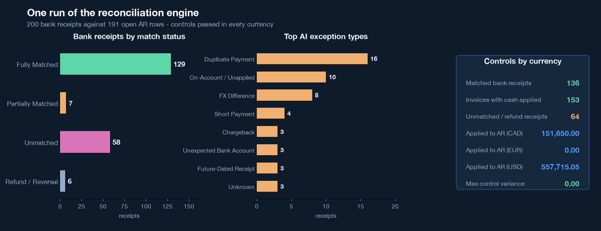

---

## Architecture

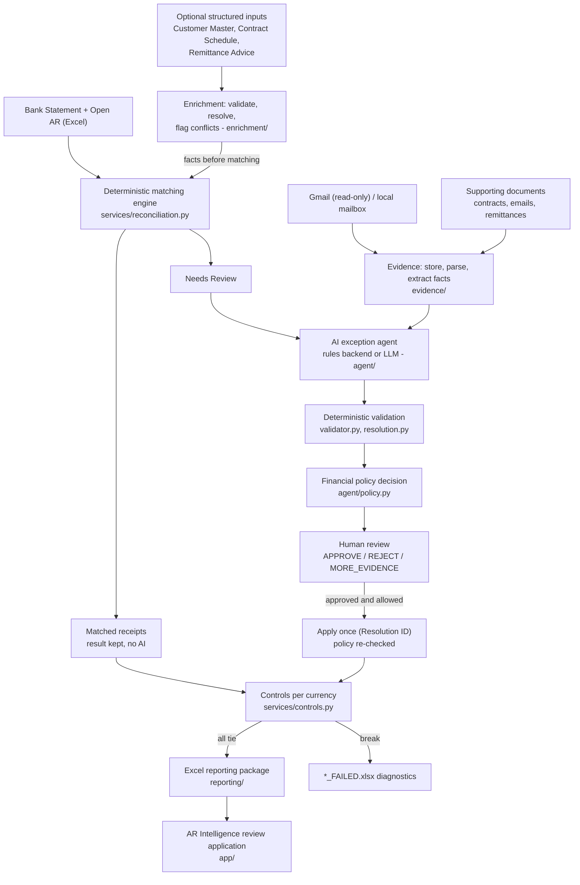

**The control boundary.** The deterministic engine is the only component that can
move money. The AI agent analyzes, explains and recommends; it never applies a
reconciliation on its own. Every AI proposal must pass the validator and the
financial policy, and it is written back to AR only after a person approves it.

**The output boundary.** Confirmed rule-based matches and AI suggestions are
reported separately and never merged into one column, and AI-generated content
is labeled as such in both the report and the application.


### The code layout

The code is layered so that the dependency direction is always downwards and a
business rule can be found in one place:

| Layer | Package | Contains |
|---|---|---|
| Primitives | `core/` | Cell parsing, money, the column vocabulary |
| Policies | `rules/` | Thresholds, tolerances, the controlled taxonomies |
| Decisions | `matching/` | The matching algorithms and their controls |
| Advice | `agent/`, `llm/` | Context building, prompting, validation, LLM clients |
| Evidence | `evidence/` | Document store, parsers, fact extraction, conflicts |
| Policy | `agent/policy.py` | The deterministic decision on whether a proposal may be executed |
| Workflows | `services/`, `agent/workflow.py` | Reconciliation, controls, analysis, decisions, application |
| Reporting | `reporting/` | Report metrics, aging, exceptions, controls matrix, Excel rendering |
| I/O | `io/` | Reading, writing, integrity checks and formatting workbooks |
| Presentation | `app/` | The AR Intelligence review application (UI only) |

A layer may use the layers below it and never the ones above. The rules in
`rules/policies.py` are the ones a Finance reviewer would audit: every tolerance
and every exception taxonomy is stated once, with the reason it has that value.

---

## Technology Stack

| Category | Technology | Status |
|----------|------------|--------|
| Language | Python 3.12 | In use |
| Data Processing | Pandas | In use |
| Excel Processing | OpenPyXL | In use |
| AI (exception analysis) | OpenAI-compatible chat API | In use, optional |
| Document parsing | pypdf, Python `email` | In use |
| Review application | Streamlit, Plotly | In use, optional (`requirements-ui.txt`) |
| UI screenshots | Playwright | Optional, development only |
| Version Control | Git | In use |

---

## Project Structure

```
.
├── src/ar_reconciliation/         # The library
│   ├── config.py                   # Project-relative paths and settings
│   ├── cli.py                      # ar-reconcile, ar-agent, ar-evidence
│   ├── core/                       # primitives.py (money, text), schema.py (columns)
│   ├── rules/policies.py           # Thresholds, tolerances, taxonomies
│   ├── matching/                   # The matching engine (memo, subset sum, candidates, application)
│   ├── agent/                      # The AI exception agent
│   │   ├── context.py              #   Candidate pool and analysis context (with evidence)
│   │   ├── prompt.py               #   System prompt and response schema
│   │   ├── rules_backend.py        #   Offline deterministic backend
│   │   ├── evidence_rules.py       #   Deterministic evidence analysis
│   │   ├── validator.py            #   Recommendation validation
│   │   ├── resolution.py           #   Allocation / adjustment validation, Resolution ID
│   │   ├── policy.py               #   Financial policy decision (FP-01 to FP-10)
│   │   ├── workflow.py             #   Analyze, record decision, apply
│   │   └── exception_agent.py      #   The agent, the approval write-back, its CLI
│   ├── enrichment/                 # Structured inputs: loaders, resolution, demo pack, before/after comparison
│   ├── evidence/                   # Supporting documents: store, parsers, extraction, samples
│   │   └── mail/                   #   Read-only mailbox sync (local .eml folder, Gmail) and email payment records
│   ├── reporting/                  # Enterprise report: metrics, aging, exceptions, controls, Excel
│   ├── llm/backend.py              # OpenAI-compatible chat backend
│   ├── services/                   # reconciliation.py, controls.py, review_rows.py
│   └── io/                         # workbook.py, integrity.py, report_views.py
├── app/                            # AR Intelligence review application
│   ├── review_app.py               #   Entry point and navigation
│   ├── views/                      #   One file per page
│   ├── ui/                         #   Backend adapter, state, components, theme, formatting, charts
│   └── assets/                     #   Logo and icon
├── .streamlit/config.toml          # Application theme and limits
├── scripts/                        # Runnable entry points
│   ├── run_reconciliation.py       #   Run the deterministic engine
│   ├── run_agent.py                #   Run the AI exception agent (and apply approvals)
│   ├── run_openai.py, run_local_model.py
│   ├── manage_evidence.py          #   Store, link, extract documents; record decisions
│   ├── make_sample_evidence.py     #   Regenerate the synthetic documents
│   ├── make_enriched_demo.py       #   Regenerate the synthetic enriched demo pack
│   ├── show_result.py              #   Inspect the result from the terminal
│   ├── check_regression.py         #   Compare a run against the baseline
│   ├── compare_runs.py             #   Compare business results of two runs
│   ├── make_images.py              #   Regenerate the README images
│   └── capture_ui_screenshots.py   #   Capture the application screenshots
├── data/
│   ├── input/                      # Source workbooks (read-only, synthetic)
│   ├── output/                     # Sample report from the synthetic data (committed)
│   ├── sample/evidence/            # Synthetic supporting documents
│   ├── sample/enriched/            # Synthetic Customer Master, contracts, remittances, mailbox, ground truth
│   └── baseline.json               # Metrics a run must reproduce
├── tests/                          # pytest suite (see Testing)
├── docs/                           # Design notes, data dictionary, metric definitions, images
├── .github/workflows/ci.yml        # Continuous integration
├── requirements.txt, requirements-dev.txt, requirements-ui.txt
└── pyproject.toml
```

All runnable entry points live in `scripts/`, and all library code lives in
`src/ar_reconciliation/`. Install the package with `pip install -e .` to get the
`ar-reconcile`, `ar-agent` and `ar-evidence` console commands.

---

## Quick Start

### 1. Install dependencies

```bash
python -m venv venv
source venv/bin/activate
python -m pip install -r requirements.txt -r requirements-dev.txt
python -m pip install -e .
```

`requirements.txt` installs `pandas`, `openpyxl`, `pypdf` and `openai`. The engine
and the rules backend need only the first two; `pypdf` reads PDF supporting
documents and `openai` is used by the LLM backend.
`pip install -e .` installs the package itself so `ar-reconcile` and `ar-agent`
are available on the command line.

### 2. Configure your API key (optional)

The deterministic engine and the rules backend need no key at all. To use the
LLM backend, put your key in a `.env` file at the repository root:

```bash
cp .env.example .env
```

Then edit `.env` and set your key:

```
OPENAI_API_KEY=sk-...
AR_AGENT_MODEL=gpt-4o-mini
```

`.env` is listed in `.gitignore` and is never committed, so your key stays out
of version control. A key already exported in your shell wins over the file,
so a per-command override still works:

```bash
OPENAI_API_KEY=sk-... python scripts/run_openai.py
```

The project reads `.env` with `python-dotenv` when it is installed and with a
built-in parser otherwise, so nothing extra is required. Install the optional
extra if you prefer it:

```bash
pip install -e ".[dotenv]"
```

### 3. Run the reconciliation engine

```bash
python scripts/run_reconciliation.py
```

This reads the two source workbooks and writes a new result workbook. **The source
files are never modified.**

```
Matched bank receipts              : 136
Matched AR invoice rows            : 158
Pending review receipts            : 67
Unmatched / exception bank receipts: 64
Data quality issues                : 0
Reconciled control difference      : 0.00
```

To look at the result without opening Excel:

```bash
python scripts/show_result.py             # the summary
python scripts/show_result.py sheets      # what is in the workbook
python scripts/show_result.py matches     # how the receipts were matched
python scripts/show_result.py unmatched   # the receipts that need a human
python scripts/show_result.py review      # what the agent recommended
python scripts/show_result.py ar          # the reconciled AR rows
```

Optionally, add the structured inputs and compare against the two-input baseline:

```bash
python scripts/run_reconciliation.py --enriched-demo --compare     # synthetic demo pack
python scripts/run_reconciliation.py --customer-master cm.csv --contracts contracts.xlsx \
    --remittance remittance.csv --compare --output result.xlsx
```

See [Evidence-Enriched Cash Application](#evidence-enriched-cash-application).

### 4. Run the AI exception agent

```bash
# Deterministic, offline. No API key required.
python scripts/run_agent.py

# LLM backend.  The key comes from .env, or from the environment.
python scripts/run_agent.py --backend llm --model gpt-4o

# Local model (Ollama / LM Studio / vLLM) — free and offline
python scripts/run_local_model.py --model qwen2.5:7b
```

The agent writes an `AI Exception Review` sheet and an `AI Exception Log` sheet
into the result workbook. The log sheet records every repair the validator made
to the model's own recommendation, and stays empty when there was nothing to
repair.

See [Free and Open-Source Model Backends](docs/local_models.md) for the local
model setup, model selection and privacy notes.

### 5. Review the report

Open the result workbook. The `AI Exception Review` sheet holds the AI's
suggestion for every receipt the engine could not settle: the exception type,
the root cause, the proposed invoice and amount, and the reasoning behind it.

This is where the MVP ends. The report is the deliverable — read it, check the
evidence, and decide what to do next.

### 6. Optionally apply human approvals

> Not part of the MVP scope — this is an optional local path for acting on the
> report. See [Roadmap](#roadmap).

If you want the agent's proposals applied back to AR, set `Approval` to
`APPROVE` on the rows you accept, then run:

```bash
python scripts/run_agent.py --apply-approved
```

Only the approved rows are applied to AR. The control totals are re-verified
afterwards, and the workbook is left untouched if they do not balance.

### 7. Resolve exceptions with supporting documents

```bash
python scripts/manage_evidence.py add remittance.pdf --txn BTRX-000178   # or: load-samples
python scripts/run_agent.py --evidence-dir data/evidence
python scripts/manage_evidence.py decide BTRX-000178 APPROVE --reviewer "Your Name"
python scripts/run_agent.py --evidence-dir data/evidence --apply-approved
```

Or do the same in the review application:

```bash
python -m pip install -r requirements-ui.txt
streamlit run app/review_app.py
```

Then, in the browser:

1. In **Settings**, enter your reviewer name.
2. In **Data Import**, choose *Use Synthetic Sample Data* (or upload your two workbooks) and run the reconciliation.
3. Read the results on the **Overview**.
4. Investigate from the **Exception Workbench**. Load the sample documents in the **Evidence Center** to see evidence-based resolutions.
5. Record decisions on the **Exception Investigation** page, apply the approved ones, then check **Financial Controls** and download the package from **Reports**.

The full demo, with the synthetic sample documents, is in
[docs/evidence_resolution.md](docs/evidence_resolution.md#9-demo).

### 8. Run the tests

```bash
python -m pip install -r requirements.txt -r requirements-dev.txt
python -m pytest tests/
```

The suite covers the money and text primitives, the matching engine, the AI
agent's safety rules and the human approval gate. It runs against the sample
data in this repository, so it exercises the real rules rather than a model of
them.

### 9. Regenerate the README images

The pictures in this README are built from a real run, so the numbers in them
are the numbers the project actually produces.

```bash
python -m pip install -r requirements-dev.txt
python scripts/make_images.py
```

---

## Testing

The matching rules are the most valuable thing in this project, and they are
also the easiest thing to break by accident. Every rule change is therefore
guarded by a test.

| Suite | What it covers |
|---|---|
| `tests/test_core.py` | Money parsing, text keys, blank detection. The edge cases that decide whether a control total is right. |
| `tests/test_engine.py` | The nine behaviours in [Scenario Coverage](docs/scenario_coverage.md), plus the invariants that hold on every run: source columns untouched, no receipt applied twice, control totals balance, no receipt silently dropped. |
| `tests/test_agent.py` | The validator: an invoice outside the candidate pool is discarded, an amount above the cash is capped, a residual is recomputed from the AR data, a review-only scenario is never auto-matched. |
| `tests/test_approval_workflow.py` | The approval gate: nothing is applied without an explicit approval, applying twice is idempotent, and the control totals still balance afterwards. |
| `tests/test_llm_backend.py` | The LLM code path: request building, JSON parsing and validation against a fake OpenAI-compatible server, with no network access and no API key. |
| `tests/test_engine_edge_cases.py` | Synthetic edge cases for the engine: ambiguity, duplicates, malformed input, instalments, the cash control and AR roll-forward. |
| `tests/test_evidence_documents.py` | Document store, PDF/email/Excel/CSV parsing, fact extraction, fabricated-fact rejection, conflicts, prompt-injection detection, masking. |
| `tests/test_evidence_resolution.py` | Evidence-based resolution end to end on a synthetic engine run, with the rules backend and a mocked LLM: every scenario, approve/reject/more evidence, apply-once, per-currency controls, audit trail, FAILED diagnostics. |
| `tests/test_enrichment.py` | Structured inputs: loaders and validation, customer resolution, identical amounts, multi-invoice, partial, authorized and unauthorized deductions, instalments, conflicting and duplicate remittances, missing evidence, deduction decisions, the demo pack against its ground truth, the comparison. |
| `tests/test_mail_sync.py` | Mailbox sync: incremental fetch, content dedupe, one parse per document, email payment records and conservative linking, a mocked Gmail API. |
| `tests/test_review_app.py` | Headless AppTest runs of the multipage UI (skipped without Streamlit): the two-input workflow renders every page; the enriched demo shows the comparison, refuses to approve an unauthorized deduction and applies an authorized one with the controls still tying. |
| `tests/test_report_views.py` | The report sheets: order, one match status per receipt, amounts tie to the detail sheets. |
| `tests/test_enterprise_reporting.py` | Multi-currency handling, FX consolidation rules, status separation, denominators, controls per currency, aging boundaries, KPI accuracy, charts, formats, empty/large datasets, formula-injection guard. |

Last full run: **312 passed**. The two-input run is unchanged by the
enrichment work: `check_regression.py` reports *No regression: all baseline
metrics match*, and `compare_runs.py` against a snapshot taken before the
change reports *No business-result differences*.

### The regression baseline

`data/baseline.json` stores the metrics a run must reproduce: row counts, the
applied-amount control totals, the status distribution and the match methods.
`scripts/check_regression.py` compares a fresh run against it:

```bash
python scripts/check_regression.py data/baseline.json
```

This answers "did the numbers move?" in one command, which is the question
you want answered before every release. If a matching rule is changed on
purpose, re-record the baseline and update the tables in
[Scenario Coverage](docs/scenario_coverage.md) in the same change.

### Continuous integration

`.github/workflows/ci.yml` runs the test suite, the offline LLM check, the
full pipeline and the baseline comparison on every push and pull request, on
Python 3.12 and 3.13.

---

## Workflow

### Step 1 — Import

Read `Bank_Cash_Receipts.xlsx` (sheet `Bank Receipts`) and `Open_AR_Detail.xlsx`
(sheet `Open AR`).

### Step 2 — Validate source data quality

Detect AR rows that are closed or reconciled but still carry a non-zero open
amount. Findings go to the `Data Quality Checks` sheet, and such rows are
excluded from auto-matching. The sheet is empty when the source data is
consistent — see [Data Quality Checks](#data-quality-checks).

### Step 3 — Extract invoice references

Parse free-text remittance memos for invoice numbers and classify the memo into a
scenario (short pay, bank fee, duplicate, dispute, and so on).

### Step 4 — Deterministic reconciliation

Run the matching engine: invoice reference first, then customer / currency /
amount combination matching with subset-sum.

### Step 5 — Auto-reconcile

Apply the confident matches to AR and to the bank receipts. Partial payments,
short pays and overpayments stay in `Pending Review`.

### Step 6 — Route to the AI Exception Agent

Every receipt that could not be reconciled is analysed by the agent, which
classifies the exception, explains the root cause and recommends a next action.

### Step 7 — Report

The confirmed matches, the unmatched receipts, the AI suggestions and the
control totals are written into the reconciliation results workbook. This is
where the MVP ends: a human reads the report and decides what to do next.

An optional local path then applies the recommendations a human approved —
see [Human-in-the-Loop Approval](#human-in-the-loop-approval).

---

## Deterministic Reconciliation Engine

`scripts/run_reconciliation.py` performs the matching. Its rules are documented in
full in [Reconciliation Logic](docs/reconciliation_logic.md).

### Match priority

| Priority | Rule | Notes |
|---|---|---|
| 1 | Memo invoice reference, exact amount | Strongest evidence of intent |
| 2 | Memo invoice reference, within rounding tolerance | ±$0.02 |
| 3 | Memo invoice reference, partial / short / overpayment | Bounded residual only |
| 4 | Customer + currency + exact amount | Single invoice |
| 5 | Customer + currency + subset-sum combination | Multiple invoices |
| 6 | Customer + currency + partial combination | Only when one candidate is plausible |

### Two-pass ordering

Receipts whose memo names an invoice are processed **first**. Receipts without a
memo reference are processed **second**, so a combination match can never consume
an invoice that a memo-referenced receipt already named.

### Key behaviours

- **Exact decimal arithmetic.** All money is converted to integer cents with
  `ROUND_HALF_UP`. No float arithmetic touches a monetary value.
- **Installments.** An invoice may be settled by several receipts. The applied
  amount and the transaction ID list accumulate, and the invoice only closes when
  the residual reaches zero.
- **Bank fees.** The invoice is cleared at the net cash received; the fee is
  flagged for a separate GL booking.
- **Controlled fallbacks.** A missing ERP Customer ID can be resolved from the
  customer name when it resolves to exactly one ERP customer. A parent entity
  paying a child's invoice is matched through the AR `Parent Customer ID`.
- **Control totals.** The AR applied amount must equal the bank applied amount
  exactly, or the run fails before anything is written.

### Source data is never modified

`Open Amount`, `AR Status` and `Reconciliation Status` in the source workbook are
never written to. Every result goes into new output columns, with the suggested
status in `Suggested Recon Status` and `Suggested Bank Status`.

### Shared primitives (`core/primitives.py`)

The engine and the AI agent both need to turn spreadsheet cells into comparable
values. Those conversions live in `src/ar_reconciliation/core/primitives.py` so
there is exactly one definition of what a cell means:

- `money_to_cents` / `cents_to_money` — money as integer cents, half-up rounding.
- `normalize_text` / `normalize_key` / `normalize_invoice` — canonical text keys.
- `is_blank` — what counts as an empty cell.

Two rules hold everywhere:

1. **Money parsing never guesses.** A value that cannot be read as an amount
   raises `MoneyParseError` instead of collapsing to zero. A silent zero is
   dangerous because every downstream control total — including the AI
   recommendation validator — would treat it as a real value and confirm it.
2. **Text keys are canonical.** `ACME-CORP`, `ACME Corp.` and `acme corp` all
   produce the same key, so the customer-name and invoice fallbacks behave the
   same on both sides of the pipeline.

---

## AI Exception Resolution Agent

`src/ar_reconciliation/agent/` analyses the receipts the deterministic engine
could not resolve. It is documented in full in [AI Exception Agent](docs/ai_exception_agent.md).

### What it does

For each unmatched receipt it produces a structured judgement:

| Field | Meaning |
|---|---|
| `AI Exception Type` | One of 20 controlled exception types |
| `Root Cause` | Why the receipt did not match |
| `Recommended Action` | Auto Match / Recommend Match / Manual Review / Hold & Escalate / Return to Customer |
| `AI Confidence` | High / Medium / Low |
| `Proposed Invoice Numbers` | The invoices it believes the cash belongs to |
| `Proposed Applied Amount` | How much to apply |
| `Proposed Residual Amount` | What stays open on the invoice |
| `Accounting Treatment` | How the accounting should be handled |
| `Proposed GL Posting` | The journal entry it would propose |
| `AI Explanation` | The narrative for the AR analyst |

### Two backends

- **`rules`** — a deterministic, offline heuristic analyzer. It is the default, so
  the pipeline runs and is testable with no API key and no network access.
- **`llm`** — an OpenAI-compatible chat-completions endpoint. This works with
  hosted APIs (OpenAI, Azure) and with **free local models** (Ollama, LM Studio,
  llama.cpp, vLLM). The model receives the receipt, its memo and the candidate
  open invoices, and returns a structured JSON judgement.

Both backends run through the **same validator**, so the safety guarantees do not
depend on which one is used.

### Structured output

The agent negotiates a grammar-constrained response format. Where the endpoint
supports `json_schema` (Ollama, llama.cpp, vLLM, OpenAI), the decoder itself
prevents an off-schema answer — the model physically cannot emit a value outside
the controlled vocabulary. Endpoints without that support fall back to plain JSON
mode, and the validator covers the difference.

This matters most for local models: a 7B model without the constraint tends to
echo the input back instead of answering.

See [Free and Open-Source Model Backends](docs/local_models.md).

### The validator

The model is never trusted. Every answer is repaired or downgraded:

- An invoice outside the candidate pool is discarded.
- An amount above the gross receipt amount is capped (decision E5: the same rule as the engine; a bank fee is booked as a fee adjustment).
- An amount above the combined open amount of the proposed invoices is capped.
- A residual that disagrees with the AR data is recomputed from the AR data.
- `Auto Match` requires `High` confidence.
- A low-confidence answer is downgraded to `Manual Review`.
- A scenario the engine marked review-only can never be auto-matched.
- A receipt with no positive net amount (refund, chargeback) can never be applied.

Every repair is recorded in the `AI Exception Log` sheet, so the gate is
auditable rather than merely asserted. That sheet is empty in this repository
because the rules backend already produces the most conservative action
available for every receipt it cannot settle, leaving the validator nothing
to downgrade — see [AI Exception Log](#ai-exception-log).

---

## Human-in-the-Loop Approval

The agent recommends. It does not decide.

```
AI recommendation ─► deterministic validation ─► financial policy decision
                                                        │
                       execution not allowed ◄──────────┤──────────► execution allowed
                       (Approve disabled;                │            (Approve enabled)
                        stays in review)                 ▼
                                               Human review
                     APPROVE ─► revalidated + policy re-checked ─► applied once ─► controls re-run
                     REJECT / MORE_EVIDENCE ─► stays in Needs Review, recorded
```

- **Decisions:** reviewers record APPROVE, REJECT or MORE_EVIDENCE, with their name, a timestamp and comments. They use the Exception Investigation page, the `AI Exception Review` sheet or `ar-evidence decide`.
- **Approval is a hard gate:** nothing is written to AR without it.
- **Exactly once:** each approved resolution is applied once, tracked by its Resolution ID.
- **Recorded:** every decision goes to Approval Records, and every balance change to the Audit Trail.
- **Approve depends on the policy:** it is available only when the financial policy allows execution. The write-back re-checks the same policy, so approving a blocked proposal in Excel is refused too.
- **Stale approvals are dropped:** an approval is carried over only while the proposal itself is unchanged.

The review workflow is a **simulated** one. The reviewer name is self-declared,
and there is no enterprise sign-in or role-based authorization.

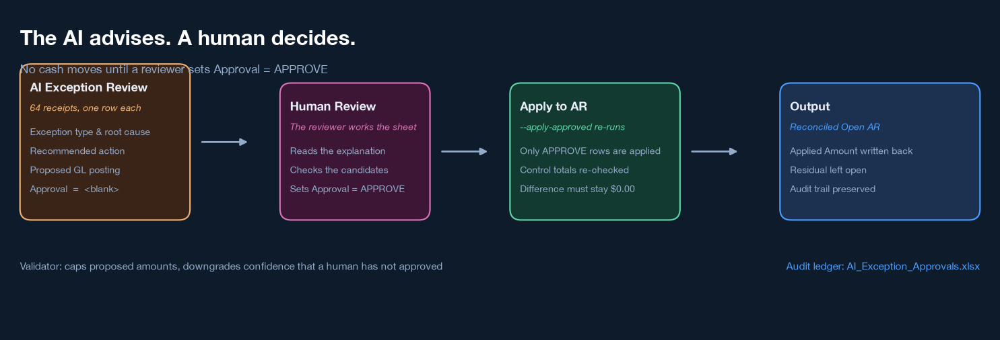

---

## Evidence-Enriched Cash Application

A bank memo often doesn't say which invoices a payment covers. The customer's
remittance advice, the contract schedule and the customer master usually do.
This layer reads those facts **before** matching, so the deterministic engine
can settle what they prove. Everything else still goes to review and to the AI
agent. The two-input workflow is unchanged when no structured file is given.

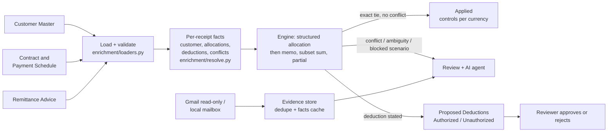

### Inputs (all optional, Excel or CSV)

| Input | Required columns | Optional columns |
|---|---|---|
| Customer Master | `customer_id`, `customer_name` | `aliases` (`;`-separated), `parent_customer_id`, `currency`, `email_domains`, `payment_terms` |
| Contract and Payment Schedule | `contract_id`, `customer_id`, `invoice_number`, `installment_amount` | `installment_number`, `installment_count`, `due_date`, `currency`, `allowed_deduction_codes`, `max_deduction_pct` |
| Remittance Advice | `remittance_id`, `invoice_number`, `amount_paid` | `payment_reference`, `bank_transaction_id`, `payer_name`, `customer_id`, `payment_date`, `currency`, `deduction_amount`, `deduction_code`, `deduction_reason` |

A file with a missing required column is rejected. Bad rows are reported in
**Data Quality Checks** and are never silently dropped. The **Data Sources &
Enrichment** sheet lists each input with its rows read and used.

### Rules (business decisions G1–G4)

- **G1. Deductions.** The engine applies the cash a remittance states. Any deduction goes to **Proposed Deductions**:
  - It is marked *Authorized* (the code and limit are allowed by the contract) or *Unauthorized*.
  - It is never applied automatically.
  - A reviewer may approve an authorized deduction. It is then posted once as a non-cash adjustment, with an approval record and an audit event, and the AR roll-forward still ties.
  - An unauthorized deduction cannot be approved as an adjustment. The balance stays open for a dispute.
- **G2. What may drive an automatic match.** Only structured files, and only when:
  - each allocation is no more than the invoice's open balance;
  - the total equals the receipt;
  - no other evidence conflicts;
  - the scenario is not review-only (holds, disputes, duplicates, currency or entity issues and the like).

  Facts from emails and PDFs feed review and the AI only.
- **G3. Customer Master.** It may resolve a missing or misstated customer ID when an alias maps to exactly one customer in the receipt's currency. Parent and third-party payers still go to review.
- **G4. Gmail.** An optional, read-only client (`gmail.readonly`, OAuth desktop flow), plus a synthetic local mailbox behind the same interface.

Remittance lines are linked to a receipt in this order:

1. the bank transaction ID;
2. the payment reference;
3. a unique payer + amount + date (±3 days).

Anything looser is not linked. Duplicate lines from a second export are ignored. Two remittances that disagree send the receipt to review with the reason.

### Mailbox sync

```bash
python -m pip install -e ".[gmail]"            # optional Google client libraries
ar-evidence sync-mail --source local --folder data/sample/enriched/mailbox \
    --customers data/sample/enriched/customer_master.csv --result result.xlsx
ar-evidence sync-mail --source gmail --query "subject:(remittance OR payment) newer_than:30d" \
    --credentials client_secret.json --customers customer_master.csv --result result.xlsx
```

- **Incremental.** Processed message IDs are kept in `mail_state.json`, so only new messages are fetched.
- **Deduplicated.** Identical content is stored once (SHA-256), whatever its message ID.
- **Cached.** Each document is parsed once (facts cache).
- **Email payment records.** Customer by sender domain, payment reference, date, invoices, amounts, deductions and reasons. A record is linked to a receipt only on an exact payment reference, or on a unique customer + amount + date.
- **Gmail credentials.**
  - Create an OAuth *Desktop* client in Google Cloud, enable the Gmail API, and save the client secret as `client_secret.json`, or point `AR_GMAIL_CLIENT_SECRET` to it.
  - The token is written to `gmail_token.json`.
  - Both files are gitignored, and no message is ever modified or sent.

### Measured before / after (synthetic enriched demo)

The same bank and AR files, run with and without the structured inputs, measured with the same definitions (`python scripts/run_reconciliation.py --enriched-demo --compare`):

| Metric | Baseline (Bank + AR) | Enriched |
|---|---|---|
| Automation rate | 68.0% | **71.0%** |
| Receipts matched automatically | 136 | **142** |
| Review workload (Pending Review) | 97 | **96** |
| Receipts needing AI investigation | 64 | **58** |
| LLM calls in the run (deterministic backend) | 0 | 0 |
| Matching accuracy: labeled outcome agreement | 45.5% (5/11) | **100.0% (11/11)** |
| Matching accuracy: correct automatic matches | N/A (0/0) | **100.0% (6/6)** |
| Cash applied to AR (USD) | 557,715.05 | **588,413.80** |
| Cash applied to AR (CAD / EUR) | 151,650.00 / 0.00 | 151,650.00 / 0.00 |
| Deductions proposed (Authorized / Unauthorized) | 0 / 0 | 1 / 1 |
| Financial controls | Passed | Passed |

Accuracy is measured against `data/sample/enriched/expected_matches.csv`, the 11 labeled scenario receipts. That is small synthetic coverage, not a production estimate.

With AI-assisted investigation on, each receipt that needs investigation is one LLM call, so six fewer receipts means six fewer calls per run.

Review workload falls by only one receipt. The authorized and unauthorized deduction receipts still wait for a reviewer by design (G1).

| Scenario | Receipt | Outcome |
|---|---|---|
| Identical invoice amounts; remittance names the invoice | BTRX-000122 | Auto-matched |
| One payment, two invoices (one partly paid) | BTRX-000165 | Auto-matched per invoice |
| Partial payment | BTRX-000172 | Applied; remainder open |
| Withholding-tax deduction allowed by contract | BTRX-000158 | Cash applied; deduction Authorized, pending approval |
| Promotional deduction not in the contract | BTRX-000194 | Cash applied; deduction Unauthorized |
| Contract instalment 1 of 2 | BTRX-000171 | Auto-matched as an instalment |
| Two remittances with conflicting instructions | BTRX-000123 | Review (conflict) |
| No evidence, identical amounts | BTRX-000125 | Review (unchanged) |
| Third-party payer | BTRX-000191 | Review |
| Remittance for an invoice on collector hold | BTRX-000168 | Review (blocked scenario) |
| Customer resolved by alias, no amount tie | BTRX-000188 | Review |
| Duplicate remittance export / duplicate email | RA-1008, mailbox copy | Ignored; never applied twice |

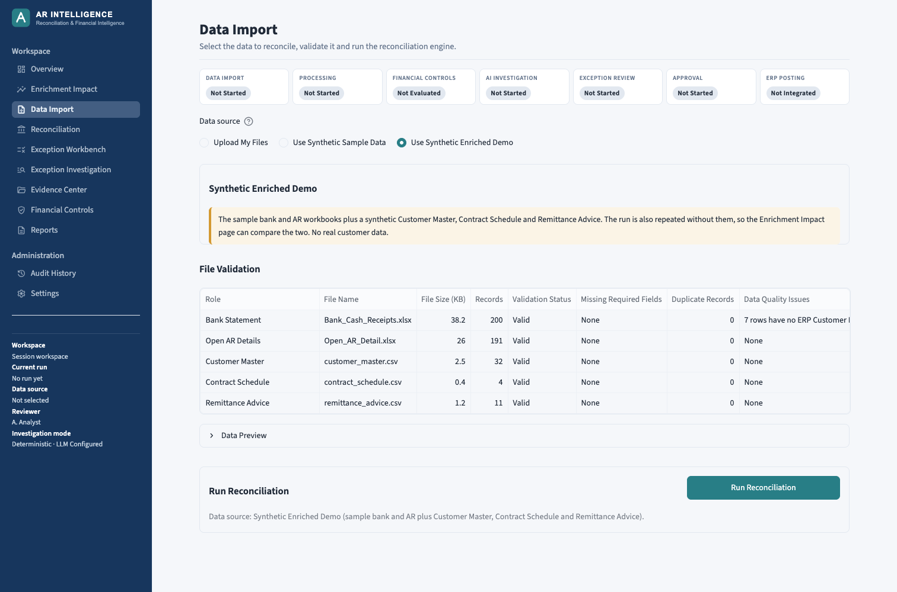

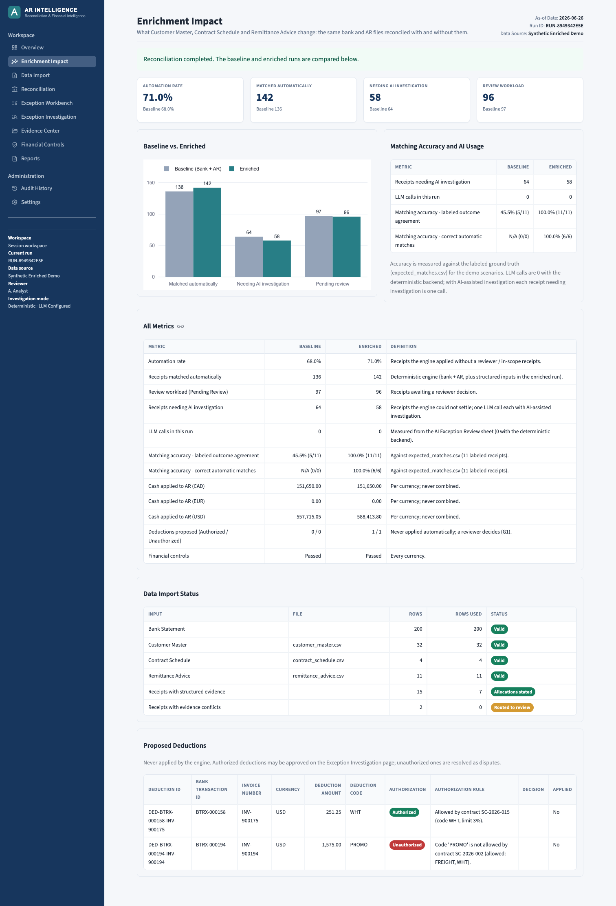

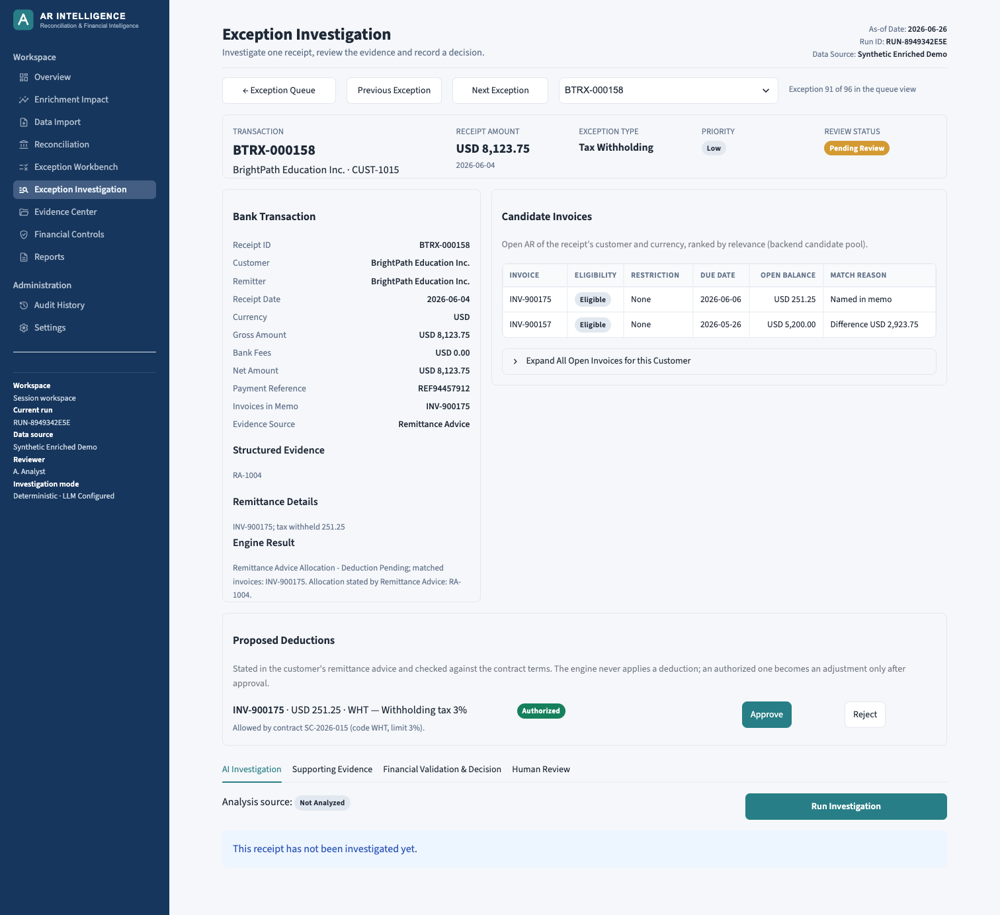

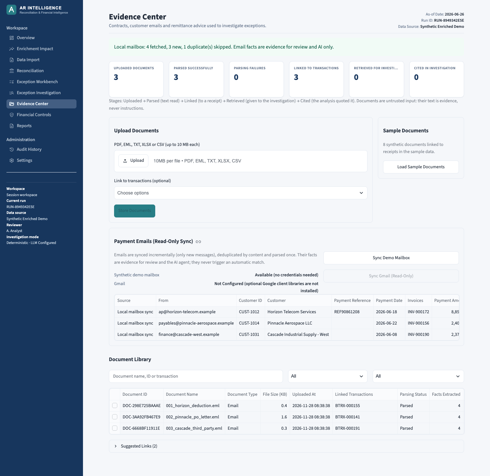

---

## Evidence-Based Exception Resolution

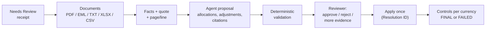

| Implemented | Not implemented (out of scope) |
|---|---|
| Manual upload of contracts, emails and remittance advice; read-only originals with hashes; read-only Gmail / local mailbox sync | Outlook, sending email, EDI 820, AP portals |
| Deterministic extraction; optional LLM extraction kept only when the quote is in the document | OCR for scanned PDFs |
| Evidence-aware rules and LLM backends with citations and sufficiency | Vector search, multi-agent orchestration |
| Validation: candidate pool, open balances, gross cash cap, discount terms and window, stated deductions, third-party only when documented | Automatic GL posting, ERP or bank API integration |
| Approve / reject / request more evidence; apply exactly once; approval records and audit trail | Multi-user approval service, SSO |
| Cash completeness and AR roll-forward per currency; FAILED diagnostics | FX revaluation between currencies |

Business decisions applied: **E1** non-cash adjustments only as Early Payment
Discount or Customer Deduction, document-backed and approved, no write-offs;
**E2** third-party payments only when a document names the invoice customer;
**E3** only masked facts and short quotes are sent to an external LLM;
**E4** optional Streamlit review UI; **E5** AI cash capped at the gross
receipt, like the engine.

Details, document requirements, the demo and known limitations:
[docs/evidence_resolution.md](docs/evidence_resolution.md).

---

## Output

The MVP produces one workbook. It carries the matching evidence for every row
— the source transaction ID, the rule that fired, the discrepancy and the
reasoning — so a reviewer can judge each match without opening the source
files.

### `Open_AR_Detail_Reconciled_Result.xlsx`

The workbook is an enterprise reporting package for the CFO, the AR manager,
the controller and the auditor. Its report sheets are rebuilt from the
system-of-record sheets every time the workbook is written, so they always
agree with the data. **Amounts are never added across currencies**: every
amount is shown with its ISO currency code, and a consolidated total appears
only when an FX-rate file (rate, date, source) is supplied.

| Level | Sheet | Purpose |
|---|---|---|
| 1 Executive | **Executive Dashboard** | Opens first. Four workflow statuses (Processing, Financial Control, Exception Review, Posting), KPI cards, cash application by currency, match vs. review status, control center, management attention, charts and navigation. |
| 1 Executive | **AR Aging & Customer Risk** | Remaining AR aged from Due Date as of the Reporting As-of Date, per currency; customer follow-up priority (operational, not a credit rating). |
| 2 Operational | **Exception Analysis** | Exceptions by category and currency, top drivers, high-priority items, confirmed vs. AI-suggested root causes. |
| 2 Operational | **Action & Review Queue** | Prioritized work queue; facts and AI suggestions in separate columns. Read-only — decisions are recorded in `AI Exception Review`. |
| 2 Operational | **Cash Application Results** | Every receipt with its cash disposition and three independent statuses (match, review, posting). |
| 2 Operational | Reconciled Open AR | AR ledger after the run (system of record). |
| 3 Controls & Audit | **Control Reconciliation** | Cash control, bank-to-AR, AR roll-forward per currency; duplicate and data quality checks; PASS / FAIL / WARNING / N/A. |
| 3 Controls & Audit | AI Exception Review | AI recommendations; reviewers record APPROVE / REJECT / MORE_EVIDENCE here. |
| 3 Controls & Audit | **AI Decision & Evidence** | Matching rule, AI recommendation (labeled AI-generated), document facts and reviewer decisions per receipt. |
| 3 Controls & Audit | Approval Records, Audit Trail, Data Quality Checks | Decisions, balance changes, input issues. |
| 4 Supporting | Processed Bank Receipts, Unmatched Bank Receipts, Supporting Documents, Extracted Evidence, AI Exception Log, Summary | Source data plus results, and the machine-readable run summary. |
| 4 Supporting | **Metric Definitions**, **Run Metadata & Configuration** | How every metric is calculated; run ID, as-of date, input hashes, thresholds. |

See [Reporting Architecture](docs/reporting_architecture.md) for the design,
the old-to-new sheet mapping and the before/after comparison, and
[Metric Definitions](docs/metric_definitions.md) for every formula.

**Confirmed matches and AI suggestions are reported separately and are never
mixed.** A row in `Reconciled Open AR` and `Processed Bank Receipts` carries a
`Match Method` — the rule that fired — and a `Reconciliation Notes` cell naming
the source transaction, the invoices it settled, the amount applied and the
reason. Those are the confirmed, rule-based matches. A row in
`AI Exception Review` carries an `AI Exception Type`, a root cause, a proposed
invoice and amount, and an `AI Explanation`; those are the suggestions, and
they are proposals only.

The two sets never share a column, so a suggestion can never be read as a
confirmed match. Nothing in this report applies cash on its own, and the
source columns `Open Amount`, `AR Status` and `Reconciliation Status` are
never modified — every result lands in a new output column.

Every reviewable sheet has a frozen header row and an auto-filter, so the
reviewer can narrow a 200-row sheet down to the receipts they need to act on.

### Reading the `Unmatched Bank Receipts` sheet

The sheet carries what a reviewer needs to judge a receipt without opening the
AR workbook:

| Column | Meaning |
|---|---|
| `Reason` | Why the engine could not reconcile the receipt. |
| `Candidate Invoice Count` | How many open AR invoices exist for this customer and currency. |
| `Candidate Open AR Total` | What those open invoices are worth in total. |
| `Suggested Invoices` | The open invoices the receipt most plausibly belongs to. |
| `Suggested Open Amount` | What those suggested invoices are worth. |
| `Receipt vs Open Difference` | How far the receipt is from settling them. |

A difference of `0.00` usually means the receipt would settle the invoice
exactly but was held back for another reason (a collector hold, a tax
withholding, a dispute) — the reviewer only has to confirm that reason, not
re-derive the match.

### Data Quality Checks

Rows of the source AR that are internally inconsistent and therefore must not
be auto-matched. The check is narrow on purpose: an AR row that is marked
`Closed` or `Reconciled` but still carries a non-zero Open Amount cannot be
matched safely, so it is reported instead of silently skipped.

| Column | Meaning |
|---|---|
| `Issue` | What is wrong with the row. |
| `AR Row Index` | The row's index in the source workbook, so the source can be corrected. |
| `ERP Customer ID`, `Customer Name`, `Invoice Number` | Which row it is. |
| `Open Amount` | The balance that should have been zero. |
| `AR Status`, `Reconciliation Status` | The status that contradicts the open amount. |
| `Recommendation` | What to do about it — review the ERP data sync or the source mapping. |

**The sheet is empty in this repository, and that is the expected result.**
The sample dataset has 191 AR rows and every one of them is `Open` in both
`AR Status` and `Reconciliation Status`, so there is no inconsistent row to
report. The sheet keeps its headers even when it is empty, so a reviewer can
tell "no issues found" apart from "the check never ran".

### AI Exception Log

The audit trail of the agent's safety gate and of the approval pass. A row is
written every time a recommendation was **changed** before it reached the
review sheet, and every time the reviewer's approval was **acted on**.

**Analysis phase** — what the agent did with its own recommendation:

| `Outcome` | What it means |
|---|---|
| `Validation` | The validator downgraded the recommendation — for example an `Auto Match` on a review-only scenario became a `Recommend Match`. The `Detail` column says which rule fired. |
| `Model Error` | The model call failed. The agent fell back to the deterministic rules backend for that receipt, and the error is recorded here. |
| `Skipped` | The receipt was not present in the processed bank receipts sheet, so it could not be analysed. |

**Approval phase** — what `--apply-approved` did with the reviewer's decision:

| `Outcome` | What it means |
|---|---|
| `Applied` | The approved amount was written to AR against the named invoices. |
| `Adjusted` | The approved amount exceeded the amount still open on the invoice, so it was capped. The receipt still received cash, just less than was approved. |
| `Rejected` | The approval could not be carried out — the row named no invoice, the invoice carried no open balance, the amount was zero or negative, or the invoice had already been applied by another receipt. The reason is in `Detail`. |
| `Skipped` | The receipt had already been applied to AR. Re-running never applies the same cash twice. |

**The sheet is empty in this repository, and that is also the expected
result.** The deterministic rules backend already recommends `Manual Review`,
`Hold / Escalate` or `Return to Customer` for every receipt it cannot settle
confidently — the most conservative action available — so there is nothing
left for the validator to downgrade, and nothing to log. The approval phase
adds nothing either, because no receipt has been approved yet.

The log is what makes the gate auditable rather than merely asserted. A
documented example: `qwen3:8b` classified `BTRX-000158`, a tax withholding
receipt, as `Short Payment` and returned `Auto Match` with `High` confidence.
The validator caught it twice over — the `Tax Withholding` scenario is
review-only in the deterministic engine, so the action was downgraded to
`Recommend Match`, and the invoice and amount it proposed were both correct.
That repair is one row in this sheet.

Both sheets keep their headers when empty, so a workbook always shows the
same shape.

---

## Current Capabilities

**Implemented**

- Invoice reference matching from free-text memos
- Customer & currency validation
- Exact amount matching
- Multi-invoice subset-sum matching
- Partial payment, short pay and overpayment handling
- Bank fee processing
- Duplicate payment detection
- Installment handling across multiple receipts
- Parent/child customer and missing-customer-ID fallbacks
- Exception reporting and control totals
- AI exception analysis with a deterministic and an LLM backend
- Human approval gate with an idempotent write-back
- Evidence-based exception resolution: document upload, fact extraction with
  citations, evidence-aware AI recommendations, deterministic validation,
  approve / reject / request more evidence, apply-once, audit trail
- Cash completeness and AR roll-forward controls, per currency, with FAILED
  diagnostics on a break
- Evidence-enriched cash application: Customer Master, Contract and Payment
  Schedule and Remittance Advice applied before matching; proposed deductions
  with reviewer decisions; read-only Gmail and local mailbox sync; a measured
  before/after comparison
- Enterprise Excel reporting package (Executive Dashboard, per-currency figures,
  metric definitions, AR aging, control matrix)
- Deterministic financial policy decision, enforced at approval
- AR Intelligence multipage review application (Streamlit, optional)
- Automated test suite covering the matching rules, the AI safety rules and
  the approval gate
- Continuous integration with a stored regression baseline

**Planned / not implemented**

- Remittance formats beyond the documented CSV / Excel layout (EDI 820,
  AP portals, lockbox files)
- An FX rate source for consolidated reporting
- A persistent, cross-session audit store
- Enterprise sign-in and role-based approval; Escalate / Modify review actions

**Out of scope for the MVP**

- Automated posting to a general ledger
- Approval workflow service, email notification and SSO
- Multi-currency revaluation and FX rate tables
- Persistent storage (the engine is file-based by design)

See [Roadmap](#roadmap) for why each of these was dropped and what the MVP
scope is instead.

---

## Roadmap

The goal is a portfolio-ready Finance AI Agent MVP: a working, demonstrable
agent — not an ERP platform.

**MVP scope**

| | |
|---|---|
| Input | Bank Statement Excel + AR Open Items Excel, plus optional supporting documents (contracts, emails, remittance advice) |
| Output | Reconciliation Results Excel |
| Storage | None. File-based, read-only sources |

The MVP stops at the report. It reads two workbooks, reconciles them against
deterministic rules, adds AI suggestions for the receipts it cannot settle,
and writes everything — the evidence and the suggestions — into one Excel
report for a human to read.

**Delivered**

- [x] Rule-based reconciliation engine — deterministic matching in exact
      integer cents, one-to-one and one-to-many
- [x] Matching evidence in the report — source transaction IDs, the rule that
      fired, the discrepancy and the reasoning, per row
- [x] AI exception investigation and matching suggestions — deterministic and
      LLM backends behind one interface; suggestions are written to the report
      as proposals, never applied
- [x] Clear separation of confirmed and suggested — rule-based matches and
      AI-suggested matches are reported separately and are never mixed
- [x] Duplicate-application prevention — a receipt is never applied twice
- [x] Regression tests — 286 tests and a stored baseline (UI tests pending)
- [x] Enterprise reporting package with per-currency controls
- [x] Financial policy enforcement at approval
- [x] AR Intelligence multipage review application
- [x] Evidence-based exception resolution — the three steps of the target
      workflow below

**Target workflow — implemented**

The existing engine stays Stage 1. Receipts the engine matches keep their
result with no AI involvement. Receipts that need review go through three
steps (①–③) before everything flows into the financial controls and the
final report. All three are implemented; see
[docs/evidence_resolution.md](docs/evidence_resolution.md).

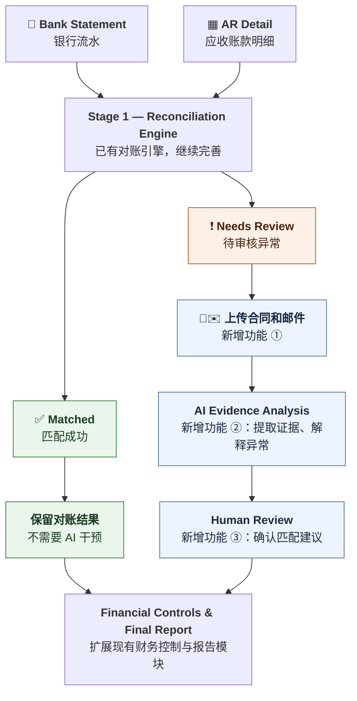

| Step | Status | Purpose |
|---|---|---|
| Bank Statement + AR Detail | Existing | Source inputs |
| Stage 1 — Reconciliation Engine | Existing, being improved | Deterministic matching and routing |
| Matched → keep result | Existing | No AI intervention for confirmed matches |
| ① Upload contracts and emails | Implemented | Supporting documents for receipts that need review |
| ② AI Evidence Analysis | Implemented | Extract evidence and explain the exception |
| ③ Human Review | Implemented | A reviewer confirms or rejects the matching suggestion |
| Financial Controls & Final Report | Implemented (extended) | Cash control, AR roll-forward and audit trail, per currency |

**Out of scope for the MVP**

The MVP deliberately stops at the report. These were considered and dropped:

| Dropped | Why |
|---|---|
| Approval workflow service | The MVP produces a report for a human to read and act on. A hosted approval flow is a deployment decision, not a demonstration requirement |
| Email notifications | The reviewer opens the report. Notification is a deployment decision |
| SSO | There is no multi-tenant user model in the MVP |
| GL posting | The agent never posts. It advises |
| Complex audit trail | The report carries the evidence per row. A separate audit system is not needed to show the reasoning |
| PostgreSQL | The engine is file-based by design |
| n8n workflow automation | Two script invocations are the whole workflow |
| Power BI dashboard | The Excel report answers the questions a dashboard would |
| Live ERP integration | Nothing posts to a ledger. The agent advises; a human decides |

The local approval path described in
[Human-in-the-Loop Approval](#human-in-the-loop-approval) still works and is
still useful for a local walkthrough, but it is not part of the MVP scope
above.

---

## Business Value

This project is designed for enterprise Finance Transformation initiatives.
Potential use cases include:

- Accounts Receivable Automation
- Finance Shared Services
- Cash Application
- Treasury Operations
- Finance Systems Modernization
- AI-Powered Finance Automation

---

## Documentation

- [Reconciliation Logic](docs/reconciliation_logic.md) — matching rules, output statuses, match methods
- [AI Exception Agent](docs/ai_exception_agent.md) — the agent's design, safety rules and review workflow
- [Free and Open-Source Model Backends](docs/local_models.md) — running the agent on a free local model
- [Enterprise UI Redesign Plan](docs/enterprise_ui_redesign_plan.md) — UI review findings, architecture and the policy control gap
- [UI Implementation Status](docs/ui_implementation_status.md) — page status, backend changes, limitations, next steps
- [Reporting Architecture](docs/reporting_architecture.md) — enterprise report design, sheet mapping, before/after, limitations
- [Metric Definitions](docs/metric_definitions.md) — definition, source, formula, denominator and currency treatment of every metric
- [Evidence-Based Exception Resolution](docs/evidence_resolution.md) — documents, extraction, validation, review, controls, demo, limitations
- [Data Dictionary](docs/data_dictionary.md) — every input and output column
- [Scenario Coverage](docs/scenario_coverage.md) — S01–S40 scenario reference and measured baseline
- [Prompt](docs/prompt.md) — the original automation specification

---

## Author

**Ke Zhang**

MS in Computer Software Engineering
Former Senior Accountant (Tesla)
AI Automation Engineer | Finance Systems | Python | Power BI | SQL

---

## License

Released under the [MIT License](LICENSE).
