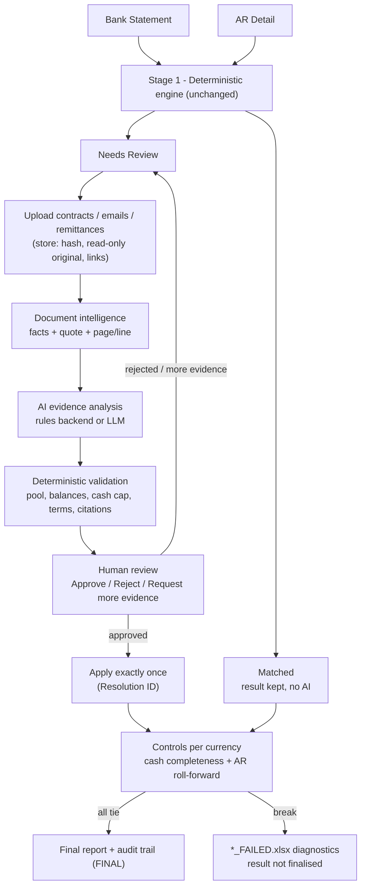

# Evidence-Based Exception Resolution

Receipts the deterministic engine cannot settle go to **Needs Review**. This
feature lets a finance user attach the customer's contract, email or
remittance advice to such a receipt. The agent extracts the payment facts,
proposes a resolution with citations, deterministic Python validates it, and
the resolution is applied once, only after a reviewer approves it.
Controls are recalculated afterwards and the report carries the full audit
trail.

> Accounting stays deterministic. The documents and the model only propose;
> Python checks every number, and a person decides.

---

## 1. Business workflow



| Stage | Module | Status |
|---|---|---|
| 1. Deterministic reconciliation | `services/reconciliation.py` | Existing, unchanged |
| 2. Document upload | `evidence/store.py` | **Implemented** |
| 3. Document intelligence | `evidence/parsers.py`, `evidence/extraction.py` | **Implemented** |
| 4. AI evidence analysis | `agent/context.py`, `agent/prompt.py`, `agent/evidence_rules.py` | **Implemented** (extends the existing agent) |
| 5. Deterministic validation | `agent/resolution.py` | **Implemented** |
| 6. Human review | `agent/workflow.py`, `app/review_app.py`, Excel review sheet | **Implemented** |
| 7. Apply approved resolution | `agent/exception_agent.py` (`_apply_resolution`) | **Implemented** |
| 8. Controls and final report | `services/controls.py`, `agent/workflow.py` | **Implemented** (extended) |

---

## 2. Document input requirements

| Type | Extensions | How it is read |
|---|---|---|
| Sales contract | `.pdf` (text-based) | `pypdf`, page by page, line by line |
| Customer email | `.eml`, `.txt` | Standard library `email`: From/To/Date/Subject, the plain-text body (HTML stripped as a fallback) and attached PDF/XLSX/CSV/TXT files |
| Remittance advice | `.pdf`, `.xlsx`, `.csv`, `.txt` | Row by row (`Sheet!row N`) or line by line |

- **Size:** at most 10 MB per file.
- **Validation:** the extension must be on the list and the content must agree with it (a `.pdf` starts with `%PDF`, an `.xlsx` is a zip, text has no binary bytes). Anything else is refused with a reason.
- **Duplicates:** the same bytes uploaded again are not stored twice; the existing document is linked to the new receipt.
- **Links:** many-to-many. One remittance can cover several receipts; one receipt can have several documents.
- **Preservation:** the original is stored byte for byte as `data/evidence/originals/<sha256>.<ext>`, read-only, with its hash, file name, upload time, uploader and linked transactions in `manifest.json`. `data/evidence/` is gitignored.
- **Not supported (by design):** scanned PDFs without a text layer are reported as "No text layer — OCR out of scope"; nothing is guessed from them.

Invoice references are read in the project's format (`INV-123456`). Amounts
are recognised when they carry cents or thousands separators (`1,200.00`,
`USD 950.00`, `7,800 CAD`); bare integers are not treated as money.

---

## 3. What is extracted

Each fact keeps its document ID, its location (`page 1, line 4`,
`body line 3`, `Remit!row 5`) and the verbatim quote it was read from.

| Field | Example source text |
|---|---|
| `invoice_number` | "This payment settles invoice INV-900156." |
| `allocation` | "INV-900160 \| 5,900.00" / "Amount paid: USD 2,400.00" next to one invoice |
| `payment_amount` | "Total payment 9,275.00" |
| `payment_date` | "Payment date: 2026-06-20" |
| `contract_number`, `credit_memo` | "Sales Contract SC-2026-011", "CM-1001" |
| `payment_terms` | "payment terms Net 45" |
| `discount_terms` | "2/10 net 30", "1.5% early payment discount … within 15 days" |
| `installment` | "Instalment 1 of 2: USD 1,700.00 due 2026-06-14" |
| `deduction`, `dispute` | "We deducted 1,000.00 for damaged equipment" |
| `payer_on_behalf_of`, `customer_name` | "remitting … on behalf of Cascade Industrial Supply" |

Two extractors produce these facts:

- **Deterministic (default):** transparent patterns, no network.
- **LLM (optional, `--llm-extract`):** structured output against a schema whose `field` is an enum. A model fact is **kept only if** its quote is found in the document, its amount appears in the quote and its invoice appears in the quote. Everything else is dropped and logged, so the model cannot add a fact the document does not contain.

**Conflicts** are detected deterministically across documents: different amounts for the same invoice, different payment totals, different discount terms, or amounts in another currency than the receipt.

---

## 4. AI exception resolution

The existing agent is extended; there is no second agent. For each receipt in
Needs Review the context now holds:

- the bank transaction and the engine's exception reason;
- the candidate open AR (same customer and currency, plus the invoices of a third-party customer named in a document);
- the extracted facts, inside a fenced `<<<EVIDENCE … EVIDENCE>>>` block labelled as untrusted;
- the conflicts and any prompt-injection warnings.

The answer (LLM or the deterministic rules backend) adds to the existing
fields:

| Field | Meaning |
|---|---|
| `proposed_allocations` | Cash per invoice |
| `proposed_adjustments` | `Early Payment Discount` or `Customer Deduction` only |
| `evidence_citations` | Document, location and exact quote relied on |
| `conflicts` | Disagreements or injection attempts noticed |
| `evidence_sufficiency` | `Sufficient`, `Insufficient` or `Conflicting` |

The rules backend proposes a resolution only when the documents say so
plainly: an explicit remittance allocation; a single named invoice paid in
full, in part or as a scheduled instalment; several named invoices whose
balances add up exactly to the receipt; a short payment explained by a stated
deduction or by discount terms that fit exactly and inside the window.
Otherwise the receipt stays in review with the reason.

**Scenarios covered** (all tested): missing invoice reference, multi-invoice
payment, partial payment, instalment, third-party payment, early-payment
discount, customer deduction, short payment, overpayment / unapplied cash,
disputed invoice, conflicting documents, missing or unreadable evidence,
prompt injection, LLM failure.

---

## 5. Deterministic validation (`agent/resolution.py`)

Nothing the model or the rules propose reaches the review sheet without these
checks, all in integer cents:

| Check | Failure |
|---|---|
| Evidence is `Sufficient` and not conflicting | Stays in review; nothing proposed |
| At least one citation is found verbatim in a linked document | Stays in review |
| Every invoice is in the candidate pool | **Rejected** |
| The invoice is not disputed and not on hold | **Rejected** |
| Each allocation is positive and ≤ the invoice's open balance | **Rejected** |
| Allocations total ≤ the receipt's gross amount (E5) | **Rejected** |
| Adjustment type is Early Payment Discount or Customer Deduction (E1) | Adjustment dropped (*Downgraded*) |
| Cash + adjustment ≤ the invoice's open balance | Adjustment dropped |
| Discount ≤ terms % × open balance, value date inside the discount window | Adjustment dropped |
| Deduction equals an amount a document states for that invoice | Adjustment dropped |
| A third-party invoice is used only when a document names that customer (E2) | Not in the pool → **Rejected** |

Business rule note: the engine holds "On-account / Unapplied" receipts (a PO
but no invoice in the memo). When a document names the invoice and the
resolution passes every check, it is proposed as **Recommend Match** for a
reviewer to approve. Every other hold-only scenario (collector hold, refund,
chargeback, credit memo, lockbox batch) stays on hold whatever the documents
say.

---

## 6. Human review and application

The reviewer works in the Streamlit page or directly in the `AI Exception
Review` sheet:

- `Approval` = `APPROVE`, `REJECT` or `MORE_EVIDENCE`, with `Reviewer`,
  `Decision Timestamp` and `Reviewer Notes`.
- The reviewer may edit `Proposed Allocations` / `Proposed Adjustments`; the
  edit is **revalidated** against the current AR and the documents before
  anything is applied (an over-allocation is rejected).

`--apply-approved` (or the page's *Apply* button):

1. revalidates every approved resolution;
2. refuses a receipt that is missing or repeated in the bank sheet;
3. writes the cash to `Applied Amount` / `AR Applied Amount Total` and, to keep
   the engine's result recoverable, to `AI-Resolved Applied Amount`; writes
   adjustments to `Approved Adjustment Amount / Type`;
4. records the `Resolution ID` on the receipt — a second attempt is logged
   "Already applied" and changes nothing;
5. appends to **Approval Records** and the **Audit Trail** (open balance
   before, cash, adjustment, open balance after, documents, reviewer).

REJECT and MORE_EVIDENCE leave the receipt in Needs Review. Nothing is ever
posted to an ERP or GL; the input files are never written.

---

## 7. Financial controls

| Control | Formula | Where |
|---|---|---|
| Cash completeness | gross receipt = applied cash + unapplied cash + fee/rounding + held for review + skipped, **per receipt** | Bank side |
| Bank vs AR | cash the bank side applied = cash the AR side received | Both |
| AR roll-forward | opening AR − applied cash − approved non-cash adjustments = remaining AR, **per invoice** | AR side |

All three run on the whole file **and per currency**. Non-cash adjustments
never enter the cash control. After approvals are applied the controls are
recalculated. If any control breaks, the run status is `FAILED`, the result
workbook is **not** updated, and a `…_FAILED.xlsx` file with a *Control
Breaks* sheet names every receipt or invoice that does not tie.

---

## 8. Security and data handling

- Document content is untrusted data: it is fenced in the prompt, a
  deterministic check flags lines addressed to an AI system ("ignore all
  previous instructions…"), and the validator limits what any answer can do.
- Decision E3: only extracted facts and quotes of at most 300 characters are
  sent to an external LLM, with email addresses, phone numbers and account
  identifiers masked. LLM extraction is off by default.
- Only synthetic documents are committed (`data/sample/evidence/`); uploads go
  to the gitignored `data/evidence/`. No API key is logged or written.

---

## 9. Demo

### Command line

```bash
python -m pip install -r requirements.txt -r requirements-dev.txt
python scripts/run_reconciliation.py --output /tmp/demo.xlsx
python scripts/manage_evidence.py --store /tmp/evidence load-samples
python scripts/run_agent.py --result /tmp/demo.xlsx --evidence-dir /tmp/evidence

python scripts/manage_evidence.py decide BTRX-000155 APPROVE --reviewer "A. Analyst" --result /tmp/demo.xlsx
python scripts/manage_evidence.py decide BTRX-000178 APPROVE --reviewer "A. Analyst" --result /tmp/demo.xlsx
python scripts/manage_evidence.py decide BTRX-000141 REJECT  --reviewer "A. Analyst" --result /tmp/demo.xlsx
python scripts/run_agent.py --result /tmp/demo.xlsx --evidence-dir /tmp/evidence --apply-approved
```

### Review UI

```bash
python -m pip install -r requirements.txt -r requirements-ui.txt
streamlit run app/review_app.py
```

Tick *Use the synthetic sample data*, run, pick a receipt (for example
`BTRX-000155`), *Load the synthetic sample documents*, *Analyse*, enter a
reviewer name, approve, *Apply*, download the report.

### What the sample documents demonstrate

| Receipt | Document | Outcome |
|---|---|---|
| BTRX-000178 | Remittance CSV | Two invoices, one paid in part — Valid |
| BTRX-000155 | Email | 8,850.00 cash + 1,000.00 customer deduction — Valid |
| BTRX-000141 | PDF letter | PO-only memo resolved to INV-900156 — Valid |
| BTRX-000171 | PDF contract | Instalment 1 of 2 — Valid, balance stays open |
| BTRX-000191 | Letter | Third-party payment for Cascade Industrial Supply — Valid, flagged |
| BTRX-000143 | Email with an injected instruction | Legitimate allocation kept, injection flagged and ignored |
| BTRX-000142 | Two conflicting documents | Conflicting — stays in review |

Measured on the sample data: approving 155, 178 and 191 applies 20,500.00 of
cash and a 1,000.00 deduction; the cash control, bank-vs-AR and the
roll-forward tie in USD, CAD and EUR; a second apply changes nothing.

---

## 10. Test results

`python -m pytest tests/` — **236 passed** (159 existing + 77 new):

| Suite | Tests | Covers |
|---|---|---|
| `tests/test_evidence_documents.py` | 39 | Store validation, duplicates, many-to-many links, tamper detection; PDF/EML/HTML/XLSX/CSV parsing; malformed, empty and scanned files; every fact type; fabricated LLM facts dropped; PII masking; conflicts; injection detection |
| `tests/test_evidence_resolution.py` | 37 | Synthetic engine run → documents → analysis (rules and mocked LLM) → decisions → apply → controls: multi-invoice, partial, instalment, discount in/out of window, deduction, third party, overpayment, conflicting, missing and malformed evidence, disputed invoice, injection, wrong invoice, over-allocation, unsupported adjustment, fabricated citation, LLM failure, approve/reject/more evidence, repeated approval, reviewer edits, duplicate transaction, per-currency controls, audit trail, FAILED diagnostics (engine and apply) |
| `tests/test_review_app.py` | 1 | Headless run of the Streamlit page through the whole acceptance path (skipped when Streamlit is not installed) |

The stored regression baseline is unchanged, and with no documents the
agent's output is identical to the previous version.

---

## 11. Known limitations

- Scanned PDFs (no text layer) are not read; OCR is out of scope.
- The deterministic extractor recognises the project's invoice format
  (`INV-…`) and amounts with cents or separators; other layouts need the LLM
  extractor or a pattern change.
- The rules backend does not split one payment across several invoices
  unless a document states the split or the balances add up exactly.
- Discounts are checked against the invoice date and the bank value date; a
  contract that measures the window from another date is not modelled.
- Third-party payments require the document to name the customer as it
  appears in the AR ledger (or its ERP customer ID).
- Controls run per currency; there is no FX conversion between currencies.
- The review UI is single-user and keeps its workspace in a temporary folder
  for the session; there is no persistence or authentication.

## 12. Planned (not implemented)

Gmail or mailbox integration, automatic email sending, ERP / bank API
integration, GL posting, OCR, vector search, SSO and multi-agent
orchestration are out of scope for this feature.
